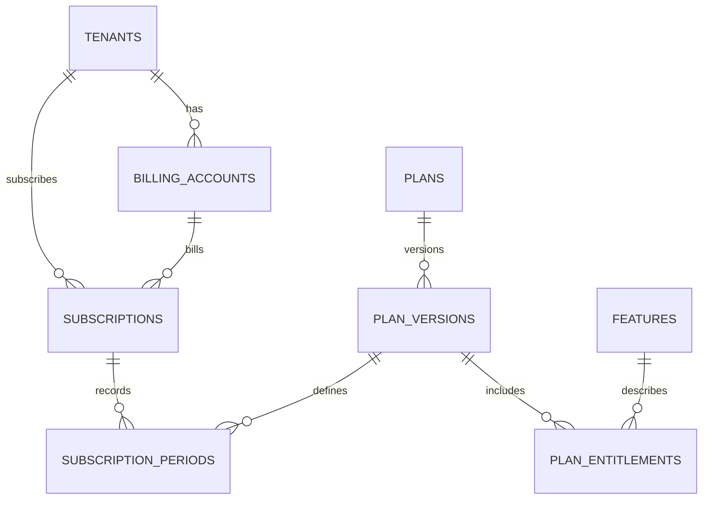
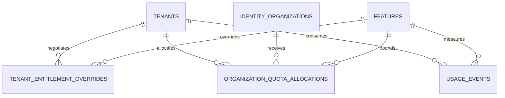

# COB3 Tenant — Schema Design Summary

**Version:** 1.0  
**Date:** 8 November 2026  
**Schema:** `cob3_tenant`  
**Companion:** `COP3_Identity_Consolidated_Schema_v1.md`

This document summarizes a proposed Tenant schema using the conventions from the consolidated Identity design. It is a design specification, not executable SQL or an applied migration. It describes the core commercial and lifecycle model, key columns, relationships, and enforcement requirements.

## 1. Naming and scope

The latest request names `cob3_tenant`; the Identity document uses `cop3_tenant`, `cop3_identity`, `cop3_settings`, and `cop3_catalog`. This document uses **`cob3_tenant` exactly as requested**. Existing companion schema names remain unchanged in references. Before implementation, choose one consistent prefix and update cross-schema references together; do not accidentally deploy two tenant masters. The attached Identity document has not been modified.

| Schema | Responsibility |
|---|---|
| `cob3_tenant` | Tenant registration, lifecycle, plan catalog, subscriptions, commercial entitlements, quota allocations, usage, billing records |
| `cop3_identity` | Organizations, humans, service accounts, automations, teams, roles, permissions, authentication and delegation |
| `cop3_settings` | Preferences, notification settings, integration configuration, operational policies |
| `cop3_catalog` | Business domains and governed assets |

**Tenant is the customer/account boundary. Organization is an operating entity inside a tenant.** Tenant-wide subscription capacity can be allocated across organizations without creating duplicate subscriptions or identity records.

Commercial entitlement and identity permission are different:

- Entitlement: this tenant purchased automation capability and a limit of 50 automations.
- Permission: this principal may create an automation in Organization A.
- Access requires both, together with tenant lifecycle eligibility and quota checks.

## 2. Principal design decisions

1. Keep one authoritative tenant master. Identity references its `tenant_id`.
2. Keep organization master and organization membership in Identity.
3. Version plans, prices and entitlements so a commercial catalog edit cannot silently change an existing contract.
4. Start with one current base subscription per tenant. Model upgrades through dated changes and periods. Add-ons and multiple product subscriptions are an explicit future extension.
5. Separate tenant operational status from subscription/payment status. A failed payment does not automatically suspend the whole tenant unless a defined grace-period policy says so.
6. Allocate tenant quotas to organizations explicitly where required; organization allocations never create additional purchased capacity.
7. Treat usage events and commercial transaction events as idempotent records. Retries must not bill twice.
8. Keep payment-card details, provider secrets and raw authentication tokens outside these tables.

## 3. Common columns and scope rules

Every table includes the following columns. An entity identifier such as `subscription_id` is additional, except for the tenant master whose identifier is `tenant_id` itself.

| Column | PostgreSQL type | Convention |
|---|---|---|
| `tenant_id` | `uuid` | Required for tenant-owned records; NULL only for explicitly platform-owned catalog records |
| `organization_id` | `uuid` | Required for organization allocations; nullable for organization-attributed usage; NULL for tenant-wide/catalog records |
| `created_at` | `timestamptz` | NOT NULL DEFAULT `now()` |
| `created_by` | `varchar(255)` | NOT NULL; stable principal/system actor |
| `updated_at` | `timestamptz` | NOT NULL DEFAULT `now()`; maintained on mutation |
| `updated_by` | `varchar(255)` | NOT NULL; trusted modifying actor |
| `metadata` | `jsonb` | NOT NULL DEFAULT `'{}'::jsonb`; JSON object only |
| `row_version` | `bigint` | NOT NULL DEFAULT `1`; positive optimistic concurrency counter |

### Scope categories

| Category | Tenant column | Organization column | Examples |
|---|---|---|---|
| Platform catalog | Must be NULL | Must be NULL | Plans, features, published prices |
| Tenant-owned | NOT NULL | Must be NULL | Subscriptions, invoices, billing accounts |
| Organization-owned | NOT NULL | NOT NULL | Organization quota allocations |
| Organization-attributed | NOT NULL | Nullable | Usage events and usage rollups |

**NULL does not mean unrestricted access.** Platform catalog tables have different, explicit read/write policies. Tenant users cannot insert or change platform prices or plans.

Global catalog ownership is a deliberate exception to the earlier tenant-owned-table convention. It avoids copying identical commercial plans into every tenant. If dedicated customer databases are introduced, replicate immutable published catalog versions into them while retaining stable catalog IDs.

### Physical conventions

- Entity identifiers: `uuid PRIMARY KEY DEFAULT gen_random_uuid()`. The tenant master has `tenant_id` as its primary key.
- Every tenant-owned table additionally has `UNIQUE (tenant_id, entity_id)` for tenant-qualified FKs. Organization-owned or attributed tables expose required organization-qualified unique keys when referenced that way.
- Every tenant-owned row references `tenants(tenant_id)`. A non-NULL organization references `cop3_identity.organizations(tenant_id, organization_id)`.
- Child references include tenant_id. Platform-catalog references use their globally unique IDs and cannot be confused with tenant-owned rows.
- Use `ON DELETE RESTRICT` and `ON UPDATE RESTRICT` by default. Hard deletion is a separate retention process.
- All required codes/names are nonblank. Stable codes are lowercase ASCII and unique at their declared scope.
- All validity windows are half-open: `[valid_from, valid_until)`. End must be greater than start. Do not put time-dependent `now()` predicates in CHECK constraints or partial indexes.
- `metadata` is for extension data, not quota rules, prices, executable policies or secrets.
- Record issued monetary totals as `bigint` minor units with a `varchar(3)` currency code. Never use floating point for monetary calculations. Unit rates may use `numeric(20,8)`; rounding uses an explicit currency/contract policy at invoice issuance.
- Creation fields are immutable. A trusted trigger updates modification fields and row_version. Append-only events keep updated fields equal to created fields and row_version=1.

## 4. Complete table inventory

| # | Table | Scope | Purpose |
|---|---|---|---|
| 1 | `tenants` | Tenant root | Customer account and lifecycle |
| 2 | `tenant_contacts` | Tenant | Commercial, support and security contacts |
| 3 | `tenant_lifecycle_events` | Tenant | Append-only lifecycle transition history |
| 4 | `provisioning_jobs` | Tenant | Idempotent onboarding/offboarding orchestration |
| 5 | `plans` | Platform | Named commercial plan families |
| 6 | `plan_versions` | Platform | Immutable published editions of plans |
| 7 | `features` | Platform | Supported commercial capabilities and quota units |
| 8 | `plan_entitlements` | Platform | Feature allowances in a plan version |
| 9 | `plan_prices` | Platform | Published price choices for a plan version |
| 10 | `billing_accounts` | Tenant | Billing-party and provider-customer references |
| 11 | `subscriptions` | Tenant | Tenant subscription lifecycle |
| 12 | `subscription_periods` | Tenant | Effective dated plan/price contract segments |
| 13 | `subscription_changes` | Tenant | Scheduled upgrades, downgrades and cancellations |
| 14 | `tenant_entitlement_overrides` | Tenant | Approved contract exceptions to plan allowances |
| 15 | `organization_quota_allocations` | Organization | Organization share of finite tenant capacity |
| 16 | `usage_events` | Attributed | Immutable metered consumption events |
| 17 | `usage_rollups` | Attributed | Rebuildable usage totals by feature and period |
| 18 | `invoices` | Tenant | Issued invoice headers and monetary snapshots |
| 19 | `invoice_lines` | Tenant | Recurring and usage charge snapshots |
| 20 | `payment_transactions` | Tenant | Payment, refund and chargeback records |
| 21 | `provider_events` | Tenant | Idempotent processing of resolved billing-provider events |

The dictionaries below list table-specific columns. Add the common columns in Section 3 to every table. `?` marks a nullable column; other listed columns are required unless a lifecycle rule states otherwise. Entity IDs default to `gen_random_uuid()`; other defaults are stated explicitly. Unspecified required fields must be supplied by the service.

## 5. Tenant lifecycle tables

### 5.1 `tenants`

| Column | Type | Meaning |
|---|---|---|
| `tenant_id` | `uuid` | Primary key; common column, not duplicated |
| `tenant_code` | `varchar(64)` | Globally unique immutable customer code |
| `name` | `varchar(200)` | Customer display name |
| `legal_name` | `varchar(255)?` | Legal customer name |
| `status` | `varchar(24)` | `provisioning`, `active`, `suspended`, `closing`, `closed`; default `provisioning` |
| `home_region` | `varchar(64)` | Approved logical data residency region |
| `activated_at` | `timestamptz?` | First activation |
| `suspended_at` | `timestamptz?` | Current suspension timestamp |
| `closed_at` | `timestamptz?` | Final closure timestamp |
| `suspension_reason` | `text?` | Required while suspended |

Constraints: organization_id must be NULL; tenant_code unique; suspended_at and suspension_reason required exactly while status=suspended; closed_at required exactly while status=closed. Active status requires activated_at. Region change is an approved migration, not a preference edit. Status transitions are controlled and recorded in tenant_lifecycle_events in the same transaction.

### 5.2 `tenant_contacts`

Columns: `tenant_contact_id uuid`, `contact_type varchar(20)` (`billing`, `technical`, `security`, `legal`), `name varchar(200)`, `email varchar(320)`, `phone varchar(32)?`, `principal_id uuid?`, `is_primary boolean DEFAULT false`, `status varchar(16) DEFAULT 'active'` (`active`, `inactive`).

Optional principal FK is `(tenant_id, principal_id)` into Identity. A contact need not have a login. Partial UNIQUE `(tenant_id, contact_type)` where is_primary=true and status=active. Contact information grants no permissions.

### 5.3 `tenant_lifecycle_events`

Columns: `tenant_lifecycle_event_id uuid`, `from_status varchar(24)?`, `to_status varchar(24)`, `occurred_at timestamptz`, `reason text`, `request_id uuid`, `actor_principal_id uuid?`.

UNIQUE `(tenant_id, request_id)`. Status values match the master; NULL from_status only for creation. Append-only. Actor is a historical reference; preserve event evidence after account pseudonymization. Current tenant master and event insert must commit atomically.

### 5.4 `provisioning_jobs`

Columns: `provisioning_job_id uuid`, `job_type varchar(24)` (`onboard`, `suspend`, `resume`, `offboard`), `idempotency_key varchar(128)`, `status varchar(20) DEFAULT 'pending'` (`pending`, `running`, `succeeded`, `failed`), `attempt_count integer DEFAULT 0`, `started_at timestamptz?`, `completed_at timestamptz?`, `next_attempt_at timestamptz?`, `lease_expires_at timestamptz?`, `last_error_code varchar(64)?`.

UNIQUE `(tenant_id, job_type, idempotency_key)`. attempt_count >= 0; running requires lease/start; succeeded/failed require completed_at. Retry state transitions clear incompatible timestamps. Use leases/row locking so competing workers cannot perform the same step concurrently. External steps must be independently idempotent; this table alone does not guarantee exactly-once execution.

## 6. Versioned commercial catalog

These five tables require tenant_id=NULL and organization_id=NULL. Only the platform commercial administrator can mutate them. Tenant users may read only plans/prices they are permitted to select through the service; a public/global row is not automatically public API data.

### 6.1 `plans`

Columns: `plan_id uuid`, `plan_code varchar(64)`, `name varchar(150)`, `description text?`, `status varchar(16) DEFAULT 'draft'` (`draft`, `active`, `retired`).

UNIQUE plan_code. Plan is a family such as Standard or Enterprise; it does not directly contain mutable customer terms.

### 6.2 `plan_versions`

Columns: `plan_version_id uuid`, `plan_id uuid`, `version_number integer`, `status varchar(16) DEFAULT 'draft'` (`draft`, `published`, `retired`), `effective_from timestamptz`, `effective_until timestamptz?`, `published_at timestamptz?`, `terms_reference varchar(255)?`.

FK plan_id -> plans. UNIQUE `(plan_id, version_number)`; version_number > 0. Valid interval ordering. Published/retired records require published_at. Publication freezes entitlement contents. Retirement prevents new selection but does not void existing contracts. Effective dates determine sellability, not automatic cancellation of existing subscriptions.

### 6.3 `features`

Columns: `feature_id uuid`, `feature_code varchar(128)`, `name varchar(150)`, `description text?`, `value_type varchar(16)` (`boolean`, `quota`), `unit_code varchar(32)?`, `measurement_kind varchar(24)` (`capability`, `gauge`, `counter`), `status varchar(16) DEFAULT 'active'` (`active`, `retired`).

UNIQUE feature_code. Boolean features require measurement_kind=capability and unit_code=NULL. Quotas require a unit and gauge/counter kind. Type/unit/measurement definition immutable after use. Example units: `count`, `byte`, `token`, `request`; bytes are not interchangeably GB/GiB.

### 6.4 `plan_entitlements`

Columns: `plan_entitlement_id uuid`, `plan_version_id uuid`, `feature_id uuid`, `is_enabled boolean DEFAULT false`, `limit_value numeric(24,6)?`, `is_unlimited boolean DEFAULT false`, `reset_period varchar(24)` (`none`, `calendar_month`, `subscription_period`).

FKs -> plan_versions, features. UNIQUE `(plan_version_id, feature_id)`. For Boolean features: no limit, no unlimited, reset=none. Enabled finite quota: nonnegative limit required, unlimited=false. Enabled unlimited quota: limit=NULL, unlimited=true. Disabled feature: limit=NULL, unlimited=false. Gauge reset=none; counters require the feature's approved reset semantics. Enforce cross-table feature type rules with a trigger. Entitlements are editable only while parent plan version is draft; lock parent during publish/edit.

Missing entitlement means disabled, not unlimited.

### 6.5 `plan_prices`

Columns: `plan_price_id uuid`, `plan_version_id uuid`, `price_code varchar(64)`, `currency_code varchar(3)`, `billing_interval varchar(16)` (`month`, `year`), `base_amount_minor bigint`, `effective_from timestamptz`, `effective_until timestamptz?`, `status varchar(16) DEFAULT 'draft'` (`draft`, `published`, `retired`), `provider_price_reference varchar(255)?`.

FK -> plan_versions. UNIQUE price_code. CHECK base_amount_minor >= 0; currency validated against the supported currency registry. Effective interval ordering. Published amounts/currency/interval are immutable. Add UNIQUE `(plan_version_id, plan_price_id)` for matching subscription-period references. Recurring base pricing only in v1: tiered add-ons, currency conversion and complex metered-rate catalogs require additional models. Usage invoice lines can reference externally calculated approved rates with retained snapshots.

## 7. Billing account and subscription tables

### 7.1 `billing_accounts`

Columns: `billing_account_id uuid`, `legal_name varchar(255)`, `billing_email varchar(320)`, `billing_address jsonb`, `country_code varchar(2)`, `provider_code varchar(64)?`, `provider_account_reference varchar(128)?`, `provider_customer_reference varchar(255)?`, `status varchar(16) DEFAULT 'active'` (`active`, `inactive`).

billing_address must be a JSON object validated to an address schema; no payment-card data. Provider fields must all be set or all NULL. Partial global UNIQUE `(provider_code, provider_account_reference, provider_customer_reference)` when populated; provider_account_reference distinguishes merchant account/environment. Keep historical billing accounts for issued invoice linkage. Changing the current account must not change invoice snapshots.

### 7.2 `subscriptions`

Columns: `subscription_id uuid`, `billing_account_id uuid`, `status varchar(24) DEFAULT 'pending'` (`pending`, `trialing`, `active`, `past_due`, `paused`, `canceled`, `expired`), `started_at timestamptz?`, `trial_ends_at timestamptz?`, `cancel_at timestamptz?`, `ended_at timestamptz?`, `provider_subscription_reference varchar(255)?`.

Tenant-qualified billing account FK. Partial UNIQUE `(tenant_id)` where status IN (`pending`,`trialing`,`active`,`past_due`,`paused`) enforces one live base subscription. Cancellation may be scheduled while current status remains active; canceled/expired require ended_at, and pending cannot supply data access. Trial end > start when both exist. Provider subscription reference is unique within its billing account's provider account; enforce through a validated indexed provider mapping or trigger. Do not use a globally unique reference without its provider account context.

Current plan and price are resolved from subscription_periods, not duplicated here.

### 7.3 `subscription_periods`

Columns: `subscription_period_id uuid`, `subscription_id uuid`, `billing_period_key varchar(128)`, `segment_number integer`, `plan_version_id uuid`, `plan_price_id uuid`, `period_start timestamptz`, `period_end timestamptz`, `currency_code varchar(3)`, `contract_amount_minor bigint`, `status varchar(16) DEFAULT 'scheduled'` (`scheduled`, `active`, `closed`).

Tenant-qualified subscription FK; compound `(plan_version_id, plan_price_id)` FK -> plan_prices. UNIQUE `(tenant_id, subscription_id, billing_period_key, segment_number)`. period_end > period_start, segment_number > 0, amount >= 0. Prevent overlapping time ranges within subscription using exclusion constraint (with required operator support) or serialized mutation. Currency must match price. A negotiated amount different from catalog price requires explicit approved contract authority and audit.

Each row is an immutable effective terms segment after activation. A midcycle change may split a billing cycle into segments sharing billing_period_key. For reset_period=subscription_period, quota reset keys use billing_period_key, not segment_number: an upgrade must not accidentally reset consumption. Full invoice cycles, proration and segment boundaries are calculated by the billing service and recorded explicitly.

### 7.4 `subscription_changes`

Columns: `subscription_change_id uuid`, `subscription_id uuid`, `change_type varchar(24)` (`upgrade`, `downgrade`, `cancel`, `resume`), `target_plan_price_id uuid?`, `effective_at timestamptz`, `status varchar(20) DEFAULT 'requested'` (`requested`, `approved`, `applied`, `rejected`, `canceled`), `requested_by_principal_id uuid?`, `approved_by_principal_id uuid?`, `approved_at timestamptz?`, `applied_at timestamptz?`, `idempotency_key varchar(128)`, `reason text`.

Tenant-qualified subscription FK; target price is global FK. Upgrade/downgrade require target price; cancel/resume require NULL target. UNIQUE `(tenant_id, idempotency_key)`. Approvals are required before applying; applied status requires approved_at and applied_at. Principal IDs use tenant-qualified Identity FKs when set. Lock subscription while applying changes and creating/splitting segments. One transaction records state and audit; external billing updates require idempotent reconciliation.

## 8. Entitlement exceptions, allocation and usage

### 8.1 `tenant_entitlement_overrides`

Columns: `tenant_entitlement_override_id uuid`, `feature_id uuid`, `is_enabled boolean`, `limit_value numeric(24,6)?`, `is_unlimited boolean DEFAULT false`, `reset_period varchar(24)` (`none`, `calendar_month`, `subscription_period`), `valid_from timestamptz`, `valid_until timestamptz`, `status varchar(16) DEFAULT 'draft'` (`draft`, `approved`, `revoked`), `approved_by varchar(255)?`, `approved_at timestamptz?`, `reason text`, `contract_reference varchar(255)?`.

Global feature FK. Same Boolean/quota shape rules as plan_entitlements. Override is a complete replacement for that feature, not an ambiguous increment. Positive ordered validity interval required. Approved status requires approval actor/time. Prevent overlapping nonrevoked approved windows per tenant/feature. Commercial platform authority approves these; a tenant administrator cannot award itself unlimited capacity. Authorized terms are immutable except revocation. Expired/revoked overrides fall back to plan entitlement.

### 8.2 `organization_quota_allocations`

Columns: `organization_quota_allocation_id uuid`, `feature_id uuid`, `allocated_limit numeric(24,6)`, `valid_from timestamptz`, `valid_until timestamptz`, `status varchar(16) DEFAULT 'active'` (`active`, `revoked`), `reason text`.

organization_id required, scoped Identity organization FK; global feature FK. Only finite numeric quota features are allocatable in v1. allocated_limit >= 0; window ordered. No overlapping active allocation windows for one tenant/org/feature. Sum of simultaneous active allocations must not exceed the finite tenant entitlement at any relevant change boundary. Serialize allocation writes per tenant/feature and validate future contract changes. If a scheduled downgrade would make allocations invalid, require reallocation before applying it.

Allocations are reserved shares. Once allocations exist for a feature, an organization without an allocation receives zero of that partitioned capacity; unused shares are not automatically borrowed. Features without allocations use a shared tenant pool. Runtime always checks aggregate tenant capacity as well as the organization's allocation. Boolean features remain tenant-wide; identity permission can still restrict organization use.

### 8.3 `usage_events`

Columns: `usage_event_id uuid`, `feature_id uuid`, `source_code varchar(64)`, `source_event_id varchar(128)`, `occurred_at timestamptz`, `received_at timestamptz DEFAULT now()`, `quantity numeric(24,6)`, `correction_of_event_id uuid?`, `request_id uuid?`.

Tenant required; optional valid organization attribution; feature global FK. UNIQUE `(tenant_id, source_code, source_event_id)`. For ordinary consumption quantity > 0 and correction=NULL. Corrections have quantity < 0 and a tenant-qualified FK to the original event; enforce same feature/org attribution. Serialize corrections to prevent cumulative reversal beyond original consumption. Reject reusing an idempotency key with a different payload.

Append-only. This event stream measures counter features only. Current gauges such as active user/automation counts and current storage footprint are read from authoritative operational stores or a transactionally maintained counter; do not sum creation events without deletions.

Do not partition this table prematurely. If later partitioned by date, preserve cross-partition event idempotency with a separate deduplication registry or a key design compatible with the partition key. A partition-local unique index is insufficient.

### 8.4 `usage_rollups`

Columns: `usage_rollup_id uuid`, `feature_id uuid`, `window_key varchar(128)`, `window_start timestamptz`, `window_end timestamptz`, `total_quantity numeric(24,6) DEFAULT 0`, `event_count bigint DEFAULT 0`, `computed_at timestamptz`, `calculation_version integer DEFAULT 1`.

Tenant required, nullable organization. Unique key `(tenant_id, organization_id, feature_id, window_key)` must treat NULL organizations as equal: use NULLS NOT DISTINCT where supported, or two partial unique indexes. CHECK end > start; event_count >= 0; calculation_version > 0. total_quantity >= 0 after validated corrections. Feature FK global.

NULL organization means usage events with no organization attribution, not a duplicate aggregate of organization rows. Tenant total sums all attribution buckets once. Rollups are rebuildable projections with transactional/incremental idempotency; do not use a timestamp watermark alone because late events may arrive. Reconcile to raw events before final billing. Async rollups cannot enforce hard quotas under concurrent requests.

## 9. Commercial transaction records

These tables are an operational billing mirror, not a tax engine, statutory accounting ledger or replacement for a billing provider. A provider's validated invoice/rate calculations or an explicitly implemented billing engine supplies amounts.

### 9.1 `invoices`

Columns: `invoice_id uuid`, `billing_account_id uuid`, `subscription_id uuid?`, `invoice_number varchar(64)?`, `currency_code varchar(3)`, `status varchar(20) DEFAULT 'draft'` (`draft`, `open`, `paid`, `void`, `uncollectible`), `issued_at timestamptz?`, `due_at timestamptz?`, `subtotal_minor bigint DEFAULT 0`, `discount_minor bigint DEFAULT 0`, `tax_minor bigint DEFAULT 0`, `total_minor bigint DEFAULT 0`, `billing_snapshot jsonb`, `provider_invoice_reference varchar(255)?`.

Tenant-qualified account/subscription FKs. UNIQUE `(tenant_id, invoice_number)` when non-NULL. Currency consistent with all lines and associated payments. Nonnegative amounts; discount <= subtotal; total = subtotal - discount + tax. billing_snapshot is an object containing the issued party/address/terms snapshot. Issued statuses require invoice_number and issued_at; due_at >= issued_at when both set. Draft lines and totals are validated atomically at issuance. Monetary fields, currency, lines and snapshot are immutable after issuance; status can change through validated collection workflows. Do not erase an issued invoice to hide a correction.

### 9.2 `invoice_lines`

Columns: `invoice_line_id uuid`, `invoice_id uuid`, `line_number integer`, `subscription_period_id uuid?`, `feature_id uuid?`, `description text`, `quantity numeric(24,6)`, `unit_price numeric(20,8)`, `line_subtotal_minor bigint`, `service_from timestamptz?`, `service_until timestamptz?`.

Tenant-qualified invoice/period FKs; optional global feature FK. UNIQUE `(tenant_id, invoice_id, line_number)`. line_number > 0, quantity >= 0, unit_price >= 0, subtotal >= 0. unit_price is in invoice currency major units; convert/round using its minor-unit exponent under explicit billing policy. Service dates both NULL or both set with end > start. Lines inherit currency from invoice. Trigger checks invoice is draft on every insert/update/delete and freezes line content after issuance. Invoice subtotal equals sum of line subtotals; cross-row totals enforced transactionally, not by an ordinary CHECK.

### 9.3 `payment_transactions`

Columns: `payment_transaction_id uuid`, `invoice_id uuid`, `parent_transaction_id uuid?`, `transaction_type varchar(20)` (`payment`, `refund`, `chargeback`), `status varchar(20) DEFAULT 'pending'` (`pending`, `succeeded`, `failed`), `amount_minor bigint`, `currency_code varchar(3)`, `provider_code varchar(64)`, `provider_account_reference varchar(128)`, `provider_transaction_reference varchar(255)`, `occurred_at timestamptz`, `failure_code varchar(64)?`.

Tenant-qualified invoice/parent FKs. UNIQUE `(provider_code, provider_account_reference, provider_transaction_reference, transaction_type)`. amount_minor > 0; currency matches invoice. Payments have NULL parent; refunds/chargebacks require parent succeeded payment, same tenant/invoice/currency. Principal amount/type/linkage immutable; pending -> succeeded/failed state transition is reconciled and audited. Lock related records to validate reversals against available payment balance and avoid double deductions. Provider-reported conflicts go to reconciliation rather than silently dropping financial facts.

v1 assumes each transaction belongs to one invoice. Split allocations, customer credits, credit notes, FX and general-ledger posting require explicit future tables; do not overload metadata. Compute paid balance from succeeded transactions; a local paid status is not trusted without reconciliation.

### 9.4 `provider_events`

Columns: `provider_event_id uuid`, `provider_code varchar(64)`, `provider_account_reference varchar(128)`, `external_event_id varchar(255)`, `event_type varchar(128)`, `occurred_at timestamptz`, `received_at timestamptz DEFAULT now()`, `payload_digest bytea`, `status varchar(20) DEFAULT 'received'` (`received`, `processing`, `processed`, `failed`), `attempt_count integer DEFAULT 0`, `lease_expires_at timestamptz?`, `processed_at timestamptz?`, `last_error_code varchar(64)?`.

UNIQUE `(provider_code, provider_account_reference, external_event_id)`. payload_digest is SHA-256 with octet_length=32. attempt_count >= 0; processing requires lease, processed requires processed_at. Verify provider authenticity before processing and resolve tenant from trusted provider-customer mappings, never from arbitrary webhook tenant fields. Unresolved events go to a restricted platform ingress queue outside this tenant-owned table. Store only redacted necessary facts; raw payment payloads are not required here.

Duplicate events are no-ops only when digest/content agrees. Out-of-order delivery must not revert a newer provider state; obtain authoritative state/version where needed and reconcile. Event receipt and local mutation are transactionally coordinated with retries.

## 10. Example feature catalog

These are proposed application capabilities, not researched market prices or license terms.

| Feature code | Type | Measurement | Unit/reset | Meaning |
|---|---|---|---|---|
| `organizations.max` | quota | gauge | count / none | Maximum active organizations |
| `humans.max` | quota | gauge | count / none | Distinct active human principals per tenant, counted once across organizations |
| `service_accounts.max` | quota | gauge | count / none | Active service-account principals |
| `automations.max` | quota | gauge | count / none | Active separate automation principals |
| `api_credentials.max` | quota | gauge | count / none | Active API credentials, including personal/service tokens |
| `storage.bytes` | quota | gauge | byte / none | Current retained chargeable storage |
| `logs.ingested_bytes` | quota | counter | byte / subscription_period | Ingested bytes in the contract billing cycle |
| `ai.tokens` | quota | counter | token / subscription_period | Metered AI tokens under explicitly defined provider accounting |
| `api.requests` | quota | counter | request / calendar_month | Counted API requests in UTC month |
| `sso.enabled` | boolean | capability | none | Entitlement to enterprise SSO configuration |
| `automation.enabled` | boolean | capability | none | Entitlement to autonomous execution |
| `lineage.enabled` | boolean | capability | none | Entitlement to lineage features |

Token credentials are not counted as automation principals. A personal token consumes credential capacity; a separately registered assistant consumes automation capacity and any credentials it owns. Feature retirement or loss of SSO entitlement must preserve a controlled recovery/billing administration path, not lock out all customer administrators.

## 11. Entitlement evaluation and quota enforcement

1. Read tenant lifecycle. Active tenants may use data-plane services; suspended/closing/closed states follow explicit access rules. Recovery, payment and approved export access are separate controlled routes.
2. Resolve the one eligible subscription and the contract segment effective at the operation time. Trials require an explicit trial plan/period; no implicit unlimited trial.
3. Resolve plan entitlement. Missing/disabled capability denies feature use.
4. Apply at most one active approved tenant override for that feature. Override is replacement, not addition.
5. Apply organization allocation where configured. Organization allocation cannot exceed effective tenant entitlement.
6. Evaluate Identity permissions and grant/credential restrictions independently.
7. For quota-consuming operations, atomically reserve/check capacity before committing work. Record measured usage with an idempotency key after completion and reconcile reservations. Long-running reservations require a durable reservation mechanism; async rollups alone are not sufficient. A reservation table/service is implementation scope beyond this summary.
8. Record lifecycle/commercial changes and invalidate affected entitlement caches. Define a bounded cache revocation period during implementation; do not promise immediate invalidation without enforcement.

Counter windows use the documented UTC calendar or contract cycle. Gauge quotas query authoritative active resources. A downgrade below existing usage normally blocks new creation/consumption or enters a defined grace process; it must not silently delete users, automations or customer data.

Organization allocation of tenant-wide distinct human counts needs a specific counting rule: v1 does not allocate humans.max by organization because one human can belong to several organizations. Add an organization-membership feature if that allocation is required.

## 12. Relationships

## 13. Indexes, isolation and operational requirements

- Tenant-scoped lookup indexes start with tenant_id; quota/usage queries generally continue with feature_id and time/window key.
- Index child FKs unless an existing leading-column index already covers them.
- Important lookups: subscriptions(tenant_id,status); subscription_periods(tenant_id,subscription_id,period_start); overrides(tenant_id,feature_id,valid_from); allocations(tenant_id,feature_id,organization_id); usage_events(tenant_id,feature_id,occurred_at); invoices(tenant_id,status,due_at); provisioning_jobs(status,next_attempt_at); provider_events(status,lease_expires_at).
- Queue scans that cross tenants are restricted platform-worker operations, not customer database access.
- Enable and force RLS on tenant-owned tables. Runtime roles are nonowner and lack superuser/BYPASSRLS. Trusted backend establishes transaction-local context. Global catalog policies explicitly separate approved reading from platform-only mutation.
- Tenant administrators cannot publish commercial plans, approve their own entitlement overrides or mark unpaid invoices paid. Those require platform-commercial authority, separate from customer tenant-admin roles.
- Use tenant-qualified composite FKs even when IDs are UUIDs. Optional organization attribution must be validated against the same tenant.
- Lifecycle events and usage events are append-only; invoice snapshots and published catalog terms are immutable. Mutable payment/provider workflow states require audit transitions rather than rewriting event facts.
- Bootstrap tenant before Identity organization/principal creation. Avoid requiring an Identity FK on tenant creation actor; a stable system actor string breaks the bootstrap cycle safely.
- Account closure first disables access, then follows approved export/retention/deletion workflows. Do not cascade-delete bills, usage evidence or audit history.

## 14. Implementation sequence and validation

1. Standardize `cob3` versus `cop3` naming and update the Identity tenant FK contract.
2. Create tenant root and lifecycle tables; bootstrap platform-provisioning authority.
3. Create global feature/plan/price catalog and publish immutable initial versions.
4. Create billing accounts, subscriptions and effective contract periods.
5. Add typed override/allocation rules and connect entitlement checks to Identity authorization.
6. Add idempotent metering, aggregation, billing-provider reconciliation and transaction mirrors.
7. Implement RLS, concurrency controls, immutability triggers and runtime tests before production.

Required tests include cross-tenant FK rejection, duplicate event rejection, concurrent quota allocation/consumption, overlapping subscription periods/overrides, immutable published prices, organization membership attribution, out-of-order provider messages, retries after partial failures, plan downgrades, suspended tenant behavior, and prevention of tenant-admin commercial self-escalation.

**Validation of this artifact:** table inventory and section consistency, common-column conventions and scope boundaries checked. No database migration has been generated or executed, and no live billing provider or production authorization system has been tested.

## 15. Fit with the Identity specification

The companion Identity document currently expects `cop3_tenant.tenants(tenant_id uuid)`. This proposed master exposes the same key shape under `cob3_tenant`; migration authors must change the schema reference or standardize the prefix first.

Identity remains authoritative for organization, principal and permission records. Tenant remains authoritative for account status and purchased capabilities. Settings holds configuration; Catalog owns domain/asset resources. The same tenant ID is propagated through all four schemas.
