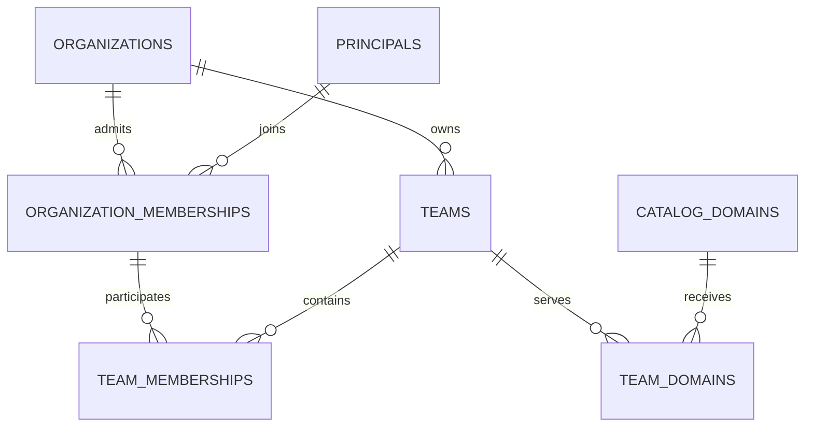
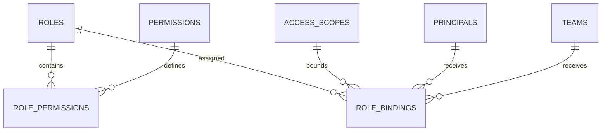
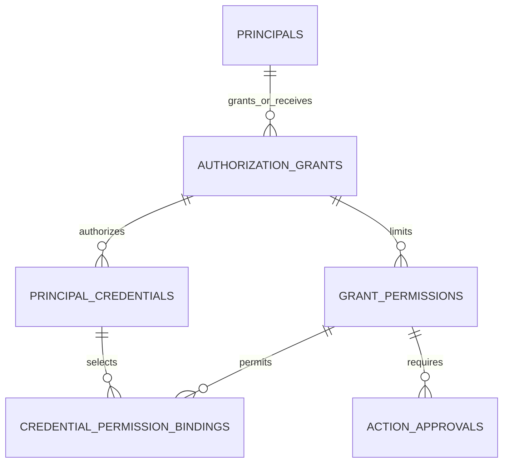

# COP3 Identity — Consolidated Schema Specification

Version 1.0 • 7 November 2026 • PostgreSQL logical/physical design specification

**Status:** complete proposed data dictionary and enforcement contract for review. This is not executable DDL, a migration, or a claim of production readiness. It reconciles the preceding discussion into one design. Database triggers, RLS policies, authorization services and migrations remain implementation work. The existing Tenant and future Catalog contracts must be matched before migration generation.

## 1. Decisions and schema ownership

| Schema | Authoritative responsibility |
|---|---|
| `cop3_tenant` | Tenant lifecycle, subscription, plan and commercial configuration |
| `cop3_identity` | Organizations, principal identities, memberships, teams, RBAC, bounded grants, credentials, federation, approvals and identity audit |
| `cop3_settings` | Preferences, trusted authentication configuration references, integration/channel settings, organization automation policy |
| `cop3_catalog` | Domain and asset masters, domain membership and resource ownership |

Organizations are defined here to preserve the agreed identity model. If the already implemented Tenant schema owns organizations, keep that master there and change references; do not duplicate it. External contract names below are proposals, not verified existing tables:

- `cop3_tenant.tenants(tenant_id uuid)` must expose a primary/unique key and active-state lookup.
- `cop3_catalog.domains(tenant_id uuid, organization_id uuid, domain_id uuid)` must expose the composite unique key and active-state lookup.
- `cop3_catalog.assets(tenant_id uuid, organization_id uuid, asset_id uuid)` must expose the composite unique key, canonical resource type and current domain membership. The initial scope model assumes one primary authorization domain per asset; multidomain tagging is not equivalent to authorization membership.
- Catalog domains/assets belong to an organization using its scoped FK. Tenant lifecycle suspension blocks access regardless of local identity status.

Only `cop3_identity` tables are specified in full here. No second domain or asset master is introduced.

## 2. Identity, grants and credentials

Principal types are `human`, `service_account`, and `automation`. An automation can be an agent, assistant, notification process or workflow. A token is a credential, not a fourth principal type.

| Use case | Principal | Grant | Credential |
|---|---|---|---|
| Human portal login | Human | Interactive RBAC; no token grant required | Trusted SSO/session |
| Personal API token | Existing human | `restricted_self`, grantor=grantee | Organization-bound API key |
| Integration API token | Existing service account | `restricted_self`, grantor=grantee | Organization-bound API key |
| Autonomous assistant | Separate automation | `delegated`, human/service grantor -> automation | API key or bounded federated session |

For credential/noninteractive access, permission on a requested resource is the intersection of **live grantor permissions, live grantee permissions, approved grant entries, and credential subset when present**. Status, lifetime, audience, membership, resource scope and usage restrictions are additional mandatory checks. For interactive human requests, evaluate current RBAC and session eligibility; an API token must never be promoted into an unrestricted interactive session.

Grantor authority is identity authority, not the continued existence of the password/session used to approve a grant. Revoking a creator's login session does not revoke separately approved grants; disabling the principal, removing membership or revoking a grant does.

Automation creation is allowed only for an authorized human or service account. No automation-to-automation delegation, self-minting, or IAM administration in v1. Tokens marked `automation` have the same restriction even when their owner is human/service; clients cannot select their own usage label. Trusted provisioning under a separately authorized service account is allowed and is audited as that service's action.

## 3. Common physical conventions

- Table names use unquoted lowercase snake_case under `cop3_identity`.
- Every table explicitly lists `tenant_id`, `organization_id`, the four audit columns, `metadata` and `row_version` below. They are not omitted from per-table dictionaries.
- Tenant-wide rows require `organization_id IS NULL`; organization-owned rows require NOT NULL. Context rows may be NULL only where specifically defined. NULL never means unrestricted access.
- Every table has `FOREIGN KEY (tenant_id) REFERENCES cop3_tenant.tenants(tenant_id)`. Every non-NULL organization value has `FOREIGN KEY (tenant_id, organization_id) REFERENCES cop3_identity.organizations(tenant_id, organization_id)`, except organizations itself, whose organization_id is its own key.
- Ordinary entity PK is `(tenant_id, <identifier>)`. Every organization-owned table except organizations additionally exposes `UNIQUE (tenant_id, organization_id, <identifier>)` for scoped child references. Profiles use principal_id as their identifier. Audit is the documented partition-key exception.
- All same-tenant references include tenant_id. All references to organization-owned rows include tenant_id and organization_id. A UUID's practical uniqueness is not a substitute for tenant/org FK enforcement.
- FK actions default to `ON UPDATE RESTRICT ON DELETE RESTRICT`, with explicit deferrable constraints where bootstrap requires them. Never cascade-delete IAM or audit history. Nullable optional composite FKs use MATCH SIMPLE only alongside checks ensuring required components cannot be absent. Explicit parent UNIQUE keys required for redundant compound references are part of this contract, even when the parent primary key already implies their uniqueness.
- UUID defaults use `gen_random_uuid()` for new entities; subtype principal IDs are supplied, never independently generated.
- A listed NULL column defaults to NULL unless otherwise stated. Required fields without defaults must be supplied by trusted application logic. CHECK constraints listed as allowed values must be emitted as SQL string-literal lists by the migration author.
- Every metadata field has CHECK `jsonb_typeof(metadata) = 'object'`. Every row_version has CHECK `row_version > 0`.
- Normalize organizational/role/team/principal/provider codes to lowercase ASCII with application validation and CHECK `code ~ '^[a-z0-9][a-z0-9_.-]*$'`. Permission codes use the same character rule and an application-owned code registry. Required display names and purpose/reason fields have CHECK `length(btrim(value)) > 0`.
- Timestamps use timestamptz; APIs display them in user timezone. Validity intervals are `[valid_from, valid_until)`.
- created_by/updated_by are stable namespaced identifiers (`principal:<uuid>` or `system:<name>`), not email/display names. They are intentionally historical audit strings rather than FK-backed identities. Typed ownership/authority columns remain real FKs.
- A trusted mutation trigger preserves creation fields, stamps update fields and increments row_version. Optimistic updates match expected row_version. Scope IDs, identity linkage and authorized grant envelopes are immutable where stated.
- No universal deleted_at/is_deleted column: lifecycle states express suspension/archive/revocation. Retention/pseudonymization is a controlled separate workflow, and business codes are not silently reused.
- No raw tokens, passwords, private keys, external-service secrets, executable expressions or security decisions in metadata.

## 4. Complete table inventory

| # | Table | Scope | Purpose |
|---|---|---|---|
| 1 | `cop3_identity.organizations` | org | Organization master; multiple organizations belong to a tenant. |
| 2 | `cop3_identity.principals` | tenant | One acting identity per tenant: person, service account, or automation. |
| 3 | `cop3_identity.user_profiles` | tenant | Human-only profile; personal token access uses the same human principal. |
| 4 | `cop3_identity.service_accounts` | org | Accountable workload identity; may provision automations only with explicit authority. |
| 5 | `cop3_identity.automation_profiles` | org | Distinct bot/agent/assistant identity; optional for simple personal or service API tokens. |
| 6 | `cop3_identity.organization_memberships` | org | Admission of a principal into an organization; no implicit data permissions. |
| 7 | `cop3_identity.teams` | org | Organization-owned team; may work across several domains within that organization. |
| 8 | `cop3_identity.team_memberships` | org | Membership of a human, service account, or automation in a team. |
| 9 | `cop3_identity.team_membership_sources` | org | Multiple justifications for membership; preserves manual membership when an external group is removed. |
| 10 | `cop3_identity.team_domains` | org | Explicit team responsibility in a Catalog domain; actual permissions come from bindings. |
| 11 | `cop3_identity.permissions` | tenant | Supported atomic operation codes; seeded by application releases, not arbitrary user expressions. |
| 12 | `cop3_identity.roles` | tenant | Reusable tenant-wide capability bundles; organization admins assign approved roles but do not edit shared definitions. |
| 13 | `cop3_identity.role_permissions` | tenant | Explicit role-to-permission associations. |
| 14 | `cop3_identity.access_scopes` | org | Immutable authorization target; references Catalog domain or asset IDs. |
| 15 | `cop3_identity.role_bindings` | org | Assign an organization-class role to exactly one principal or team at a scope. |
| 16 | `cop3_identity.tenant_role_bindings` | tenant | Tenant control-plane grants; no automatic organization data access. |
| 17 | `cop3_identity.authorization_grants` | org | Approved ceiling shared by personal tokens, service credentials, and automations. |
| 18 | `cop3_identity.authorization_grant_permissions` | org | Explicit approved atomic permission + scope entries; never store a role as a ceiling. |
| 19 | `cop3_identity.principal_credentials` | org | COP3-issued API keys for humans, services, or automations; tokens remain credentials, not principals. |
| 20 | `cop3_identity.credential_permission_bindings` | org | Per-credential subset of approved grant entries; empty subset denies all access. |
| 21 | `cop3_identity.action_approvals` | org | Single-use approval of exact sensitive action; approval never creates additional permission. |
| 22 | `cop3_identity.identity_providers` | tenant | Trusted SSO or workload authentication authority. |
| 23 | `cop3_identity.external_identities` | tenant | Trusted provider subject -> principal mapping for human/service/automation authentication. |
| 24 | `cop3_identity.external_groups` | tenant | Trusted directory group metadata, not application permissions. |
| 25 | `cop3_identity.group_team_mappings` | org | Explicit organization admission path from an external group to a team. |
| 26 | `cop3_identity.auth_sessions` | context | Revocable human sessions or bounded noninteractive sessions exchanged from trusted authentication. |
| 27 | `cop3_identity.audit_events` | context | Append-only identity and authorization event stream; partition monthly on occurred_at when needed. |

Scope legend: tenant = organization NULL; org = organization required; context = nullable with explicit contextual checks.

## 5. Full column dictionary

### 1. `cop3_identity.organizations`

Organization master; multiple organizations belong to a tenant.

**Primary key:** `(tenant_id, organization_id)`. **Scope:** `org`.

| Column | PostgreSQL type | Nullability / default | Meaning / row checks |
|---|---|---|---|
| `tenant_id` | `uuid` | NOT NULL; no default | Tenant isolation; FK to the authoritative Tenant master. |
| `organization_id` | `uuid` | NOT NULL; no default | Owning/context organization; never an access wildcard. |
| `organization_code` | `varchar(64)` | NOT NULL; no default | Normalized stable code; code-format rule applies. |
| `name` | `varchar(200)` | NOT NULL; no default | Nonblank display name. |
| `legal_name` | `varchar(255)` | NULL; no default | Legal name. |
| `description` | `text` | NULL; no default | Description. |
| `parent_organization_id` | `uuid` | NULL; no default | Optional parent in the same tenant. |
| `status` | `varchar(20)` | NOT NULL; DEFAULT 'active' | CHECK: active, suspended, archived. |
| `created_at` | `timestamptz` | NOT NULL; DEFAULT now() | Creation timestamp; immutable. |
| `created_by` | `varchar(255)` | NOT NULL; no default | Stable authenticated actor, e.g. principal:<uuid> or system:bootstrap. |
| `updated_at` | `timestamptz` | NOT NULL; DEFAULT now() | Stamped by database mutation trigger. |
| `updated_by` | `varchar(255)` | NOT NULL; no default | Authenticated last-modifying actor. |
| `metadata` | `jsonb` | NOT NULL; DEFAULT '{}'::jsonb; JSON object only | Nonsecurity extension fields; no secrets or executable policies. |
| `row_version` | `bigint` | NOT NULL; DEFAULT 1; > 0 | Optimistic concurrency counter. |

**Additional constraints and enforcement**

- UNIQUE (tenant_id, organization_code).
- FK (tenant_id, parent_organization_id) -> organizations(tenant_id, organization_id). CHECK parent_organization_id IS NULL OR parent_organization_id <> organization_id.
- Cycle prevention with hierarchy mutations serialized per tenant. Organization parentage grants no inherited access.

**Additional lookup indexes**

- `(tenant_id, parent_organization_id)`

### 2. `cop3_identity.principals`

One acting identity per tenant: person, service account, or automation.

**Primary key:** `(tenant_id, principal_id)`. **Scope:** `tenant`.

| Column | PostgreSQL type | Nullability / default | Meaning / row checks |
|---|---|---|---|
| `tenant_id` | `uuid` | NOT NULL; no default | Tenant isolation; FK to the authoritative Tenant master. |
| `principal_id` | `uuid` | NOT NULL; DEFAULT gen_random_uuid() | Entity identifier. |
| `organization_id` | `uuid` | NULL; CHECK (organization_id IS NULL) | Owning/context organization; never an access wildcard. |
| `principal_type` | `varchar(20)` | NOT NULL; no default | CHECK: human, service_account, automation; immutable. |
| `principal_code` | `varchar(128)` | NOT NULL; no default | Normalized stable code; code-format rule applies. |
| `display_name` | `varchar(200)` | NOT NULL; no default | Nonblank display name. |
| `status` | `varchar(20)` | NOT NULL; DEFAULT 'active' | CHECK: active, suspended, disabled. |
| `auth_version` | `bigint` | NOT NULL; DEFAULT 1 | Positive counter; invalidate authentication when incremented. |
| `last_authenticated_at` | `timestamptz` | NULL; no default | Last successful authentication. |
| `created_at` | `timestamptz` | NOT NULL; DEFAULT now() | Creation timestamp; immutable. |
| `created_by` | `varchar(255)` | NOT NULL; no default | Stable authenticated actor, e.g. principal:<uuid> or system:bootstrap. |
| `updated_at` | `timestamptz` | NOT NULL; DEFAULT now() | Stamped by database mutation trigger. |
| `updated_by` | `varchar(255)` | NOT NULL; no default | Authenticated last-modifying actor. |
| `metadata` | `jsonb` | NOT NULL; DEFAULT '{}'::jsonb; JSON object only | Nonsecurity extension fields; no secrets or executable policies. |
| `row_version` | `bigint` | NOT NULL; DEFAULT 1; > 0 | Optimistic concurrency counter. |

**Additional constraints and enforcement**

- UNIQUE (tenant_id, principal_code).
- CHECK auth_version > 0. Principal type is immutable. Exactly one matching subtype is required by a deferred constraint trigger at transaction commit.
- Status is the master kill switch; every authentication and authorization path must check it.

**Additional lookup indexes**

- `(tenant_id, principal_type, status)`

### 3. `cop3_identity.user_profiles`

Human-only profile; personal token access uses the same human principal.

**Primary key:** `(tenant_id, principal_id)`. **Scope:** `tenant`.

| Column | PostgreSQL type | Nullability / default | Meaning / row checks |
|---|---|---|---|
| `tenant_id` | `uuid` | NOT NULL; no default | Tenant isolation; FK to the authoritative Tenant master. |
| `principal_id` | `uuid` | NOT NULL; no default; inherited principal ID | Entity identifier. |
| `organization_id` | `uuid` | NULL; CHECK (organization_id IS NULL) | Owning/context organization; never an access wildcard. |
| `email` | `varchar(320)` | NULL; no default | Contact email; not an authentication identifier. |
| `email_verified_at` | `timestamptz` | NULL; no default | Email verification timestamp. |
| `given_name` | `varchar(100)` | NULL; no default | Given name. |
| `family_name` | `varchar(100)` | NULL; no default | Family name. |
| `job_title` | `varchar(150)` | NULL; no default | Job title. |
| `avatar_uri` | `text` | NULL; no default | URI of externally stored avatar. |
| `description` | `text` | NULL; no default | Profile description. |
| `created_at` | `timestamptz` | NOT NULL; DEFAULT now() | Creation timestamp; immutable. |
| `created_by` | `varchar(255)` | NOT NULL; no default | Stable authenticated actor, e.g. principal:<uuid> or system:bootstrap. |
| `updated_at` | `timestamptz` | NOT NULL; DEFAULT now() | Stamped by database mutation trigger. |
| `updated_by` | `varchar(255)` | NOT NULL; no default | Authenticated last-modifying actor. |
| `metadata` | `jsonb` | NOT NULL; DEFAULT '{}'::jsonb; JSON object only | Nonsecurity extension fields; no secrets or executable policies. |
| `row_version` | `bigint` | NOT NULL; DEFAULT 1; > 0 | Optimistic concurrency counter. |

**Additional constraints and enforcement**

- FK (tenant_id, principal_id) -> principals. Subtype must be human.
- CHECK email_verified_at IS NULL OR email IS NOT NULL. Email uniqueness is not imposed; SSO identity is provider + subject.

**Additional lookup indexes**

- `(tenant_id, lower(email)) WHERE email IS NOT NULL`

### 4. `cop3_identity.service_accounts`

Accountable workload identity; may provision automations only with explicit authority.

**Primary key:** `(tenant_id, principal_id)`. **Scope:** `org`.

| Column | PostgreSQL type | Nullability / default | Meaning / row checks |
|---|---|---|---|
| `tenant_id` | `uuid` | NOT NULL; no default | Tenant isolation; FK to the authoritative Tenant master. |
| `principal_id` | `uuid` | NOT NULL; no default; inherited principal ID | Entity identifier. |
| `organization_id` | `uuid` | NOT NULL; no default | Owning/context organization; never an access wildcard. |
| `creator_principal_id` | `uuid` | NOT NULL; no default | Immutable human/service creator. |
| `owner_principal_id` | `uuid` | NOT NULL; no default | Accountable human owner in this organization. |
| `purpose` | `text` | NOT NULL; no default | Nonblank purpose. |
| `expires_at` | `timestamptz` | NULL; no default | Account lifetime limit. |
| `created_at` | `timestamptz` | NOT NULL; DEFAULT now() | Creation timestamp; immutable. |
| `created_by` | `varchar(255)` | NOT NULL; no default | Stable authenticated actor, e.g. principal:<uuid> or system:bootstrap. |
| `updated_at` | `timestamptz` | NOT NULL; DEFAULT now() | Stamped by database mutation trigger. |
| `updated_by` | `varchar(255)` | NOT NULL; no default | Authenticated last-modifying actor. |
| `metadata` | `jsonb` | NOT NULL; DEFAULT '{}'::jsonb; JSON object only | Nonsecurity extension fields; no secrets or executable policies. |
| `row_version` | `bigint` | NOT NULL; DEFAULT 1; > 0 | Optimistic concurrency counter. |

**Additional constraints and enforcement**

- FK principal -> principals; subtype service_account. Creator and owner use scoped organization_memberships FKs.
- Creator type human/service_account; owner human. Account itself has organization membership. Deferred validation handles initial creation.
- CHECK expires_at IS NULL OR expires_at > created_at. Do not duplicate workload subjects here; external_identities owns provider mappings.

**Additional lookup indexes**

- `(tenant_id, organization_id, owner_principal_id)`

### 5. `cop3_identity.automation_profiles`

Distinct bot/agent/assistant identity; optional for simple personal or service API tokens.

**Primary key:** `(tenant_id, principal_id)`. **Scope:** `org`.

| Column | PostgreSQL type | Nullability / default | Meaning / row checks |
|---|---|---|---|
| `tenant_id` | `uuid` | NOT NULL; no default | Tenant isolation; FK to the authoritative Tenant master. |
| `principal_id` | `uuid` | NOT NULL; no default; inherited principal ID | Entity identifier. |
| `organization_id` | `uuid` | NOT NULL; no default | Owning/context organization; never an access wildcard. |
| `creator_principal_id` | `uuid` | NOT NULL; no default | Immutable initiating human/service principal; not merely the executing backend. |
| `owner_principal_id` | `uuid` | NOT NULL; no default | Accountable human owner. |
| `purpose` | `text` | NOT NULL; no default | Nonblank automation purpose. |
| `automation_category` | `varchar(24)` | NOT NULL; no default | CHECK: assistant, agent, notification, workflow. |
| `creation_method` | `varchar(24)` | NOT NULL; no default | CHECK: portal, api, provisioning. |
| `expires_at` | `timestamptz` | NULL; no default | Automation lifetime limit. |
| `created_at` | `timestamptz` | NOT NULL; DEFAULT now() | Creation timestamp; immutable. |
| `created_by` | `varchar(255)` | NOT NULL; no default | Stable authenticated actor, e.g. principal:<uuid> or system:bootstrap. |
| `updated_at` | `timestamptz` | NOT NULL; DEFAULT now() | Stamped by database mutation trigger. |
| `updated_by` | `varchar(255)` | NOT NULL; no default | Authenticated last-modifying actor. |
| `metadata` | `jsonb` | NOT NULL; DEFAULT '{}'::jsonb; JSON object only | Nonsecurity extension fields; no secrets or executable policies. |
| `row_version` | `bigint` | NOT NULL; DEFAULT 1; > 0 | Optimistic concurrency counter. |

**Additional constraints and enforcement**

- FK principal -> principals; subtype automation. Creator and owner use scoped organization_memberships FKs.
- Creator human/service_account only; owner human. Automation must have membership in owning organization.
- CHECK expires_at IS NULL OR expires_at > created_at. Creator immutable. Changing owner does not transfer grant authority.
- Automation cannot create principals/automations, mint credentials, change grants, or administer IAM in this version.

**Additional lookup indexes**

- `(tenant_id, organization_id, owner_principal_id)`

### 6. `cop3_identity.organization_memberships`

Admission of a principal into an organization; no implicit data permissions.

**Primary key:** `(tenant_id, organization_membership_id)`. **Scope:** `org`.

| Column | PostgreSQL type | Nullability / default | Meaning / row checks |
|---|---|---|---|
| `tenant_id` | `uuid` | NOT NULL; no default | Tenant isolation; FK to the authoritative Tenant master. |
| `organization_membership_id` | `uuid` | NOT NULL; DEFAULT gen_random_uuid() | Entity identifier. |
| `organization_id` | `uuid` | NOT NULL; no default | Owning/context organization; never an access wildcard. |
| `principal_id` | `uuid` | NOT NULL; no default | Tenant principal. |
| `membership_type` | `varchar(20)` | NOT NULL; no default | CHECK: employee, contractor, guest, service, automation. |
| `status` | `varchar(20)` | NOT NULL; DEFAULT 'invited' | CHECK: invited, active, suspended, revoked. |
| `valid_from` | `timestamptz` | NOT NULL; DEFAULT now() | Start of half-open validity window. |
| `valid_until` | `timestamptz` | NULL; no default | Exclusive end; NULL means no scheduled expiry. |
| `joined_at` | `timestamptz` | NULL; no default | Activation timestamp. |
| `revoked_at` | `timestamptz` | NULL; no default | Required exactly when status is revoked. |
| `created_at` | `timestamptz` | NOT NULL; DEFAULT now() | Creation timestamp; immutable. |
| `created_by` | `varchar(255)` | NOT NULL; no default | Stable authenticated actor, e.g. principal:<uuid> or system:bootstrap. |
| `updated_at` | `timestamptz` | NOT NULL; DEFAULT now() | Stamped by database mutation trigger. |
| `updated_by` | `varchar(255)` | NOT NULL; no default | Authenticated last-modifying actor. |
| `metadata` | `jsonb` | NOT NULL; DEFAULT '{}'::jsonb; JSON object only | Nonsecurity extension fields; no secrets or executable policies. |
| `row_version` | `bigint` | NOT NULL; DEFAULT 1; > 0 | Optimistic concurrency counter. |

**Additional constraints and enforcement**

- UNIQUE (tenant_id, organization_id, principal_id). FK (tenant_id, principal_id) -> principals.
- CHECK valid_until IS NULL OR valid_until > valid_from. Effective state is evaluated against current time, never with now() in a CHECK or partial-index predicate.
- CHECK ((status = 'revoked') = (revoked_at IS NOT NULL)).
- Type validation: service -> service_account; automation -> automation; employee/contractor/guest -> human. Membership status is checked on every request.

**Additional lookup indexes**

- `(tenant_id, principal_id, status)`

### 7. `cop3_identity.teams`

Organization-owned team; may work across several domains within that organization.

**Primary key:** `(tenant_id, team_id)`. **Scope:** `org`.

| Column | PostgreSQL type | Nullability / default | Meaning / row checks |
|---|---|---|---|
| `tenant_id` | `uuid` | NOT NULL; no default | Tenant isolation; FK to the authoritative Tenant master. |
| `team_id` | `uuid` | NOT NULL; DEFAULT gen_random_uuid() | Entity identifier. |
| `organization_id` | `uuid` | NOT NULL; no default | Owning/context organization; never an access wildcard. |
| `team_code` | `varchar(64)` | NOT NULL; no default | Normalized stable code. |
| `name` | `varchar(200)` | NOT NULL; no default | Nonblank display name. |
| `description` | `text` | NULL; no default | Description. |
| `team_type` | `varchar(24)` | NOT NULL; no default | CHECK: department, functional, project, support, security. |
| `parent_team_id` | `uuid` | NULL; no default | Parent in same tenant and organization. |
| `status` | `varchar(20)` | NOT NULL; DEFAULT 'active' | CHECK: active, suspended, archived. |
| `created_at` | `timestamptz` | NOT NULL; DEFAULT now() | Creation timestamp; immutable. |
| `created_by` | `varchar(255)` | NOT NULL; no default | Stable authenticated actor, e.g. principal:<uuid> or system:bootstrap. |
| `updated_at` | `timestamptz` | NOT NULL; DEFAULT now() | Stamped by database mutation trigger. |
| `updated_by` | `varchar(255)` | NOT NULL; no default | Authenticated last-modifying actor. |
| `metadata` | `jsonb` | NOT NULL; DEFAULT '{}'::jsonb; JSON object only | Nonsecurity extension fields; no secrets or executable policies. |
| `row_version` | `bigint` | NOT NULL; DEFAULT 1; > 0 | Optimistic concurrency counter. |

**Additional constraints and enforcement**

- UNIQUE (tenant_id, organization_id, team_code). Scoped parent FK -> teams.
- CHECK parent_team_id IS NULL OR parent_team_id <> team_id. Prevent cycles with organization-serialized hierarchy mutations.
- No nested-team permission inheritance in v1; structure is informational.

**Additional lookup indexes**

- `(tenant_id, organization_id, parent_team_id)`

### 8. `cop3_identity.team_memberships`

Membership of a human, service account, or automation in a team.

**Primary key:** `(tenant_id, team_membership_id)`. **Scope:** `org`.

| Column | PostgreSQL type | Nullability / default | Meaning / row checks |
|---|---|---|---|
| `tenant_id` | `uuid` | NOT NULL; no default | Tenant isolation; FK to the authoritative Tenant master. |
| `team_membership_id` | `uuid` | NOT NULL; DEFAULT gen_random_uuid() | Entity identifier. |
| `organization_id` | `uuid` | NOT NULL; no default | Owning/context organization; never an access wildcard. |
| `team_id` | `uuid` | NOT NULL; no default | Scoped team FK. |
| `principal_id` | `uuid` | NOT NULL; no default | Scoped organization-membership FK. |
| `membership_role` | `varchar(20)` | NOT NULL; DEFAULT 'member' | CHECK: member, maintainer, owner. |
| `status` | `varchar(20)` | NOT NULL; DEFAULT 'active' | CHECK: active, suspended, revoked. |
| `valid_from` | `timestamptz` | NOT NULL; DEFAULT now() | Start of half-open validity window. |
| `valid_until` | `timestamptz` | NULL; no default | Exclusive end; NULL means no scheduled expiry. |
| `revoked_at` | `timestamptz` | NULL; no default | Required exactly when status is revoked. |
| `created_at` | `timestamptz` | NOT NULL; DEFAULT now() | Creation timestamp; immutable. |
| `created_by` | `varchar(255)` | NOT NULL; no default | Stable authenticated actor, e.g. principal:<uuid> or system:bootstrap. |
| `updated_at` | `timestamptz` | NOT NULL; DEFAULT now() | Stamped by database mutation trigger. |
| `updated_by` | `varchar(255)` | NOT NULL; no default | Authenticated last-modifying actor. |
| `metadata` | `jsonb` | NOT NULL; DEFAULT '{}'::jsonb; JSON object only | Nonsecurity extension fields; no secrets or executable policies. |
| `row_version` | `bigint` | NOT NULL; DEFAULT 1; > 0 | Optimistic concurrency counter. |

**Additional constraints and enforcement**

- UNIQUE (tenant_id, organization_id, team_id, principal_id). Scoped FKs to teams and organization_memberships.
- CHECK valid_until IS NULL OR valid_until > valid_from. Effective state is evaluated against current time, never with now() in a CHECK or partial-index predicate.
- CHECK ((status = 'revoked') = (revoked_at IS NOT NULL)).
- membership_role is descriptive governance, not a data permission. Team management APIs still require explicit permissions.
- Effective membership requires at least one active unexpired membership source. A suspended membership blocks all sources.

**Additional lookup indexes**

- `(tenant_id, organization_id, principal_id, status)`
- `(tenant_id, organization_id, team_id, status)`

### 9. `cop3_identity.team_membership_sources`

Multiple justifications for membership; preserves manual membership when an external group is removed.

**Primary key:** `(tenant_id, team_membership_source_id)`. **Scope:** `org`.

| Column | PostgreSQL type | Nullability / default | Meaning / row checks |
|---|---|---|---|
| `tenant_id` | `uuid` | NOT NULL; no default | Tenant isolation; FK to the authoritative Tenant master. |
| `team_membership_source_id` | `uuid` | NOT NULL; DEFAULT gen_random_uuid() | Entity identifier. |
| `organization_id` | `uuid` | NOT NULL; no default | Owning/context organization; never an access wildcard. |
| `team_membership_id` | `uuid` | NOT NULL; no default | Scoped membership FK. |
| `source_type` | `varchar(20)` | NOT NULL; no default | CHECK: manual, external_group. |
| `group_team_mapping_id` | `uuid` | NULL; no default | Scoped mapping FK for external-group sources. |
| `status` | `varchar(20)` | NOT NULL; DEFAULT 'active' | CHECK: active, revoked. |
| `valid_from` | `timestamptz` | NOT NULL; DEFAULT now() | Start of half-open validity window. |
| `valid_until` | `timestamptz` | NULL; no default | Exclusive end; NULL means no scheduled expiry. |
| `revoked_at` | `timestamptz` | NULL; no default | Required exactly when status is revoked. |
| `created_at` | `timestamptz` | NOT NULL; DEFAULT now() | Creation timestamp; immutable. |
| `created_by` | `varchar(255)` | NOT NULL; no default | Stable authenticated actor, e.g. principal:<uuid> or system:bootstrap. |
| `updated_at` | `timestamptz` | NOT NULL; DEFAULT now() | Stamped by database mutation trigger. |
| `updated_by` | `varchar(255)` | NOT NULL; no default | Authenticated last-modifying actor. |
| `metadata` | `jsonb` | NOT NULL; DEFAULT '{}'::jsonb; JSON object only | Nonsecurity extension fields; no secrets or executable policies. |
| `row_version` | `bigint` | NOT NULL; DEFAULT 1; > 0 | Optimistic concurrency counter. |

**Additional constraints and enforcement**

- CHECK manual source has NULL mapping and external_group source has non-NULL mapping. Scoped FKs -> team_memberships and group_team_mappings.
- CHECK valid_until IS NULL OR valid_until > valid_from. Effective state is evaluated against current time, never with now() in a CHECK or partial-index predicate.
- CHECK ((status = 'revoked') = (revoked_at IS NOT NULL)).
- Partial UNIQUE (tenant_id, organization_id, team_membership_id) WHERE status=active AND source_type=manual.
- Partial UNIQUE (tenant_id, organization_id, team_membership_id, group_team_mapping_id) WHERE status=active AND source_type=external_group.
- Trigger verifies source mapping and membership target same team. Runtime also requires mapping/provider/group active and synchronization freshness policy satisfied.

**Additional lookup indexes**

- `(tenant_id, organization_id, team_membership_id, status)`
- `(tenant_id, organization_id, group_team_mapping_id)`

### 10. `cop3_identity.team_domains`

Explicit team responsibility in a Catalog domain; actual permissions come from bindings.

**Primary key:** `(tenant_id, team_domain_id)`. **Scope:** `org`.

| Column | PostgreSQL type | Nullability / default | Meaning / row checks |
|---|---|---|---|
| `tenant_id` | `uuid` | NOT NULL; no default | Tenant isolation; FK to the authoritative Tenant master. |
| `team_domain_id` | `uuid` | NOT NULL; DEFAULT gen_random_uuid() | Entity identifier. |
| `organization_id` | `uuid` | NOT NULL; no default | Owning/context organization; never an access wildcard. |
| `team_id` | `uuid` | NOT NULL; no default | Scoped team FK. |
| `domain_id` | `uuid` | NOT NULL; no default | Scoped FK to cop3_catalog.domains. |
| `responsibility_type` | `varchar(24)` | NOT NULL; no default | CHECK: owner, steward, operator, contributor. |
| `status` | `varchar(20)` | NOT NULL; DEFAULT 'active' | CHECK: active, suspended, revoked. |
| `created_at` | `timestamptz` | NOT NULL; DEFAULT now() | Creation timestamp; immutable. |
| `created_by` | `varchar(255)` | NOT NULL; no default | Stable authenticated actor, e.g. principal:<uuid> or system:bootstrap. |
| `updated_at` | `timestamptz` | NOT NULL; DEFAULT now() | Stamped by database mutation trigger. |
| `updated_by` | `varchar(255)` | NOT NULL; no default | Authenticated last-modifying actor. |
| `metadata` | `jsonb` | NOT NULL; DEFAULT '{}'::jsonb; JSON object only | Nonsecurity extension fields; no secrets or executable policies. |
| `row_version` | `bigint` | NOT NULL; DEFAULT 1; > 0 | Optimistic concurrency counter. |

**Additional constraints and enforcement**

- UNIQUE (tenant_id, organization_id, team_id, domain_id). Scoped FKs -> teams and Catalog domains.
- No cross-organization responsibility in v1. Domain ownership is not a second master in Identity.

**Additional lookup indexes**

- `(tenant_id, organization_id, domain_id, status)`

### 11. `cop3_identity.permissions`

Supported atomic operation codes; seeded by application releases, not arbitrary user expressions.

**Primary key:** `(tenant_id, permission_id)`. **Scope:** `tenant`.

| Column | PostgreSQL type | Nullability / default | Meaning / row checks |
|---|---|---|---|
| `tenant_id` | `uuid` | NOT NULL; no default | Tenant isolation; FK to the authoritative Tenant master. |
| `permission_id` | `uuid` | NOT NULL; DEFAULT gen_random_uuid() | Entity identifier. |
| `organization_id` | `uuid` | NULL; CHECK (organization_id IS NULL) | Owning/context organization; never an access wildcard. |
| `permission_code` | `varchar(128)` | NOT NULL; no default | Normalized dotted code, e.g. incident.read. |
| `resource_type` | `varchar(64)` | NOT NULL; no default | Canonical supported resource type. |
| `action` | `varchar(64)` | NOT NULL; no default | Canonical operation. |
| `description` | `text` | NULL; no default | Description. |
| `permission_class` | `varchar(20)` | NOT NULL; no default | CHECK: tenant_control, organization. |
| `is_delegable` | `boolean` | NOT NULL; DEFAULT false | May be included in approved authorization grants. |
| `automation_allowed` | `boolean` | NOT NULL; DEFAULT false | May be executed by automations or credentials marked automation. |
| `is_identity_management` | `boolean` | NOT NULL; DEFAULT false | Identifies IAM mutations; automation execution always rejects these. |
| `status` | `varchar(20)` | NOT NULL; DEFAULT 'active' | CHECK: active, deprecated. |
| `created_at` | `timestamptz` | NOT NULL; DEFAULT now() | Creation timestamp; immutable. |
| `created_by` | `varchar(255)` | NOT NULL; no default | Stable authenticated actor, e.g. principal:<uuid> or system:bootstrap. |
| `updated_at` | `timestamptz` | NOT NULL; DEFAULT now() | Stamped by database mutation trigger. |
| `updated_by` | `varchar(255)` | NOT NULL; no default | Authenticated last-modifying actor. |
| `metadata` | `jsonb` | NOT NULL; DEFAULT '{}'::jsonb; JSON object only | Nonsecurity extension fields; no secrets or executable policies. |
| `row_version` | `bigint` | NOT NULL; DEFAULT 1; > 0 | Optimistic concurrency counter. |

**Additional constraints and enforcement**

- UNIQUE (tenant_id, permission_code). UNIQUE (tenant_id, resource_type, action).
- Codes, class, resource and action immutable after use. Changing security flags is a restricted audited release/administration operation.
- CHECK NOT (automation_allowed AND is_identity_management). CHECK permission_class <> tenant_control OR NOT automation_allowed.
- Deprecated permissions no longer authorize actions; migrate role assignments before deprecation.

**Additional lookup indexes**

- Primary/unique and required referencing-side FK indexes are sufficient initially.

### 12. `cop3_identity.roles`

Reusable tenant-wide capability bundles; organization admins assign approved roles but do not edit shared definitions.

**Primary key:** `(tenant_id, role_id)`. **Scope:** `tenant`.

| Column | PostgreSQL type | Nullability / default | Meaning / row checks |
|---|---|---|---|
| `tenant_id` | `uuid` | NOT NULL; no default | Tenant isolation; FK to the authoritative Tenant master. |
| `role_id` | `uuid` | NOT NULL; DEFAULT gen_random_uuid() | Entity identifier. |
| `organization_id` | `uuid` | NULL; CHECK (organization_id IS NULL) | Owning/context organization; never an access wildcard. |
| `role_code` | `varchar(64)` | NOT NULL; no default | Normalized stable code. |
| `name` | `varchar(150)` | NOT NULL; no default | Nonblank display name. |
| `description` | `text` | NULL; no default | Description. |
| `role_class` | `varchar(20)` | NOT NULL; no default | CHECK: tenant_control, organization. |
| `is_system` | `boolean` | NOT NULL; DEFAULT false | Managed system template. |
| `status` | `varchar(20)` | NOT NULL; DEFAULT 'active' | CHECK: active, disabled, archived. |
| `created_at` | `timestamptz` | NOT NULL; DEFAULT now() | Creation timestamp; immutable. |
| `created_by` | `varchar(255)` | NOT NULL; no default | Stable authenticated actor, e.g. principal:<uuid> or system:bootstrap. |
| `updated_at` | `timestamptz` | NOT NULL; DEFAULT now() | Stamped by database mutation trigger. |
| `updated_by` | `varchar(255)` | NOT NULL; no default | Authenticated last-modifying actor. |
| `metadata` | `jsonb` | NOT NULL; DEFAULT '{}'::jsonb; JSON object only | Nonsecurity extension fields; no secrets or executable policies. |
| `row_version` | `bigint` | NOT NULL; DEFAULT 1; > 0 | Optimistic concurrency counter. |

**Additional constraints and enforcement**

- UNIQUE (tenant_id, role_code). Role class immutable after use.
- No role-to-role inheritance or implicit owner wildcard. System role modifications require controlled administration.

**Additional lookup indexes**

- Primary/unique and required referencing-side FK indexes are sufficient initially.

### 13. `cop3_identity.role_permissions`

Explicit role-to-permission associations.

**Primary key:** `(tenant_id, role_permission_id)`. **Scope:** `tenant`.

| Column | PostgreSQL type | Nullability / default | Meaning / row checks |
|---|---|---|---|
| `tenant_id` | `uuid` | NOT NULL; no default | Tenant isolation; FK to the authoritative Tenant master. |
| `role_permission_id` | `uuid` | NOT NULL; DEFAULT gen_random_uuid() | Entity identifier. |
| `organization_id` | `uuid` | NULL; CHECK (organization_id IS NULL) | Owning/context organization; never an access wildcard. |
| `role_id` | `uuid` | NOT NULL; no default | Tenant-scoped role FK. |
| `permission_id` | `uuid` | NOT NULL; no default | Tenant-scoped permission FK. |
| `created_at` | `timestamptz` | NOT NULL; DEFAULT now() | Creation timestamp; immutable. |
| `created_by` | `varchar(255)` | NOT NULL; no default | Stable authenticated actor, e.g. principal:<uuid> or system:bootstrap. |
| `updated_at` | `timestamptz` | NOT NULL; DEFAULT now() | Stamped by database mutation trigger. |
| `updated_by` | `varchar(255)` | NOT NULL; no default | Authenticated last-modifying actor. |
| `metadata` | `jsonb` | NOT NULL; DEFAULT '{}'::jsonb; JSON object only | Nonsecurity extension fields; no secrets or executable policies. |
| `row_version` | `bigint` | NOT NULL; DEFAULT 1; > 0 | Optimistic concurrency counter. |

**Additional constraints and enforcement**

- UNIQUE (tenant_id, role_id, permission_id). Tenant-scoped FKs -> roles and permissions.
- Trigger verifies role_class = permission_class. Role changes do not enlarge a previously approved token grant.

**Additional lookup indexes**

- `(tenant_id, permission_id, role_id)`

### 14. `cop3_identity.access_scopes`

Immutable authorization target; references Catalog domain or asset IDs.

**Primary key:** `(tenant_id, scope_id)`. **Scope:** `org`.

| Column | PostgreSQL type | Nullability / default | Meaning / row checks |
|---|---|---|---|
| `tenant_id` | `uuid` | NOT NULL; no default | Tenant isolation; FK to the authoritative Tenant master. |
| `scope_id` | `uuid` | NOT NULL; DEFAULT gen_random_uuid() | Entity identifier. |
| `organization_id` | `uuid` | NOT NULL; no default | Owning/context organization; never an access wildcard. |
| `scope_type` | `varchar(20)` | NOT NULL; no default | CHECK: organization, domain, asset. |
| `domain_id` | `uuid` | NULL; no default | Catalog domain FK. |
| `asset_id` | `uuid` | NULL; no default | Catalog asset FK. |
| `include_contained_assets` | `boolean` | NOT NULL; DEFAULT false | Explicit asset containment; not recursive domain inheritance. |
| `status` | `varchar(20)` | NOT NULL; DEFAULT 'active' | CHECK: active, disabled. |
| `created_at` | `timestamptz` | NOT NULL; DEFAULT now() | Creation timestamp; immutable. |
| `created_by` | `varchar(255)` | NOT NULL; no default | Stable authenticated actor, e.g. principal:<uuid> or system:bootstrap. |
| `updated_at` | `timestamptz` | NOT NULL; DEFAULT now() | Stamped by database mutation trigger. |
| `updated_by` | `varchar(255)` | NOT NULL; no default | Authenticated last-modifying actor. |
| `metadata` | `jsonb` | NOT NULL; DEFAULT '{}'::jsonb; JSON object only | Nonsecurity extension fields; no secrets or executable policies. |
| `row_version` | `bigint` | NOT NULL; DEFAULT 1; > 0 | Optimistic concurrency counter. |

**Additional constraints and enforcement**

- CHECK target shape: organization -> neither domain nor asset; domain -> domain only; asset -> asset only. Asset scope requires include_contained_assets=false.
- Scoped FKs to Catalog domains and assets. Target and containment fields immutable after use.
- Partial UNIQUE (tenant_id, organization_id, include_contained_assets) WHERE scope_type=organization.
- Partial UNIQUE (tenant_id, organization_id, domain_id, include_contained_assets) WHERE scope_type=domain.
- Partial UNIQUE (tenant_id, organization_id, asset_id) WHERE scope_type=asset.
- Organization scope covers organization entity; containment additionally covers its assets. Domain scope covers domain entity; containment additionally covers directly assigned assets. Permission resource_type must also match target operation.
- Domains and teams are not organization-contained assets by default. Administration of these entities uses an explicit organization-scoped API permission.

**Additional lookup indexes**

- `(tenant_id, organization_id, domain_id) WHERE domain_id IS NOT NULL`
- `(tenant_id, organization_id, asset_id) WHERE asset_id IS NOT NULL`

### 15. `cop3_identity.role_bindings`

Assign an organization-class role to exactly one principal or team at a scope.

**Primary key:** `(tenant_id, role_binding_id)`. **Scope:** `org`.

| Column | PostgreSQL type | Nullability / default | Meaning / row checks |
|---|---|---|---|
| `tenant_id` | `uuid` | NOT NULL; no default | Tenant isolation; FK to the authoritative Tenant master. |
| `role_binding_id` | `uuid` | NOT NULL; DEFAULT gen_random_uuid() | Entity identifier. |
| `organization_id` | `uuid` | NOT NULL; no default | Owning/context organization; never an access wildcard. |
| `role_id` | `uuid` | NOT NULL; no default | Tenant-scoped role FK. |
| `scope_id` | `uuid` | NOT NULL; no default | Organization-scoped scope FK. |
| `principal_id` | `uuid` | NULL; no default | Scoped organization-membership FK. |
| `team_id` | `uuid` | NULL; no default | Scoped team FK. |
| `status` | `varchar(20)` | NOT NULL; DEFAULT 'active' | CHECK: active, revoked. |
| `valid_from` | `timestamptz` | NOT NULL; DEFAULT now() | Start of half-open validity window. |
| `valid_until` | `timestamptz` | NULL; no default | Exclusive end; NULL means no scheduled expiry. |
| `revoked_at` | `timestamptz` | NULL; no default | Required exactly when status is revoked. |
| `grant_reason` | `text` | NOT NULL; no default | Nonblank reason. |
| `approval_reference` | `varchar(255)` | NULL; no default | Optional external approval reference. |
| `created_at` | `timestamptz` | NOT NULL; DEFAULT now() | Creation timestamp; immutable. |
| `created_by` | `varchar(255)` | NOT NULL; no default | Stable authenticated actor, e.g. principal:<uuid> or system:bootstrap. |
| `updated_at` | `timestamptz` | NOT NULL; DEFAULT now() | Stamped by database mutation trigger. |
| `updated_by` | `varchar(255)` | NOT NULL; no default | Authenticated last-modifying actor. |
| `metadata` | `jsonb` | NOT NULL; DEFAULT '{}'::jsonb; JSON object only | Nonsecurity extension fields; no secrets or executable policies. |
| `row_version` | `bigint` | NOT NULL; DEFAULT 1; > 0 | Optimistic concurrency counter. |

**Additional constraints and enforcement**

- CHECK exactly one of principal_id and team_id is non-NULL. Scoped FKs -> scope, team, membership; tenant FK -> role.
- CHECK valid_until IS NULL OR valid_until > valid_from. Effective state is evaluated against current time, never with now() in a CHECK or partial-index predicate.
- CHECK ((status = 'revoked') = (revoked_at IS NOT NULL)).
- Partial UNIQUE (tenant_id, organization_id, principal_id, role_id, scope_id) WHERE status=active AND principal_id IS NOT NULL. Analogous UNIQUE for team_id.
- Role class organization only. Domain team binding requires matching active team_domains; asset team binding requires responsibility for asset current domain. Reject asset team bindings when asset has no domain; use direct principal grant or approved org-wide team grant instead.
- Organization-wide team bindings are explicit exceptions granting broader scope. They are never inferred from a team-domain relationship.

**Additional lookup indexes**

- `(tenant_id, organization_id, principal_id, status) WHERE principal_id IS NOT NULL`
- `(tenant_id, organization_id, team_id, status) WHERE team_id IS NOT NULL`
- `(tenant_id, organization_id, scope_id, role_id)`

### 16. `cop3_identity.tenant_role_bindings`

Tenant control-plane grants; no automatic organization data access.

**Primary key:** `(tenant_id, tenant_role_binding_id)`. **Scope:** `tenant`.

| Column | PostgreSQL type | Nullability / default | Meaning / row checks |
|---|---|---|---|
| `tenant_id` | `uuid` | NOT NULL; no default | Tenant isolation; FK to the authoritative Tenant master. |
| `tenant_role_binding_id` | `uuid` | NOT NULL; DEFAULT gen_random_uuid() | Entity identifier. |
| `organization_id` | `uuid` | NULL; CHECK (organization_id IS NULL) | Owning/context organization; never an access wildcard. |
| `principal_id` | `uuid` | NOT NULL; no default | Tenant principal FK; human/service only. |
| `role_id` | `uuid` | NOT NULL; no default | Tenant role FK; tenant_control only. |
| `status` | `varchar(20)` | NOT NULL; DEFAULT 'active' | CHECK: active, revoked. |
| `valid_from` | `timestamptz` | NOT NULL; DEFAULT now() | Start of half-open validity window. |
| `valid_until` | `timestamptz` | NULL; no default | Exclusive end; NULL means no scheduled expiry. |
| `revoked_at` | `timestamptz` | NULL; no default | Required exactly when status is revoked. |
| `grant_reason` | `text` | NOT NULL; no default | Nonblank reason. |
| `approval_reference` | `varchar(255)` | NULL; no default | Optional approval. |
| `created_at` | `timestamptz` | NOT NULL; DEFAULT now() | Creation timestamp; immutable. |
| `created_by` | `varchar(255)` | NOT NULL; no default | Stable authenticated actor, e.g. principal:<uuid> or system:bootstrap. |
| `updated_at` | `timestamptz` | NOT NULL; DEFAULT now() | Stamped by database mutation trigger. |
| `updated_by` | `varchar(255)` | NOT NULL; no default | Authenticated last-modifying actor. |
| `metadata` | `jsonb` | NOT NULL; DEFAULT '{}'::jsonb; JSON object only | Nonsecurity extension fields; no secrets or executable policies. |
| `row_version` | `bigint` | NOT NULL; DEFAULT 1; > 0 | Optimistic concurrency counter. |

**Additional constraints and enforcement**

- Partial UNIQUE (tenant_id, principal_id, role_id) WHERE status=active.
- CHECK valid_until IS NULL OR valid_until > valid_from. Effective state is evaluated against current time, never with now() in a CHECK or partial-index predicate.
- CHECK ((status = 'revoked') = (revoked_at IS NOT NULL)).
- Tenant-scoped FKs -> principals, roles. Reject automation recipients. Protect last active human tenant administrator with serialized administration workflow.
- This version exposes tenant-control actions only through approved interactive human sessions or a separate bootstrap channel. Organization-scoped API grants cannot exercise tenant-control permissions.

**Additional lookup indexes**

- `(tenant_id, principal_id, status)`

### 17. `cop3_identity.authorization_grants`

Approved ceiling shared by personal tokens, service credentials, and automations.

**Primary key:** `(tenant_id, authorization_grant_id)`. **Scope:** `org`.

| Column | PostgreSQL type | Nullability / default | Meaning / row checks |
|---|---|---|---|
| `tenant_id` | `uuid` | NOT NULL; no default | Tenant isolation; FK to the authoritative Tenant master. |
| `authorization_grant_id` | `uuid` | NOT NULL; DEFAULT gen_random_uuid() | Entity identifier. |
| `organization_id` | `uuid` | NOT NULL; no default | Owning/context organization; never an access wildcard. |
| `grantor_principal_id` | `uuid` | NOT NULL; no default | Source of current authority. |
| `grantee_principal_id` | `uuid` | NOT NULL; no default | Principal exercising authority. |
| `grant_type` | `varchar(24)` | NOT NULL; no default | CHECK: restricted_self, delegated. |
| `status` | `varchar(20)` | NOT NULL; DEFAULT 'draft' | CHECK: draft, active, suspended, revoked. |
| `valid_from` | `timestamptz` | NOT NULL; DEFAULT now() | Inclusive start. |
| `valid_until` | `timestamptz` | NOT NULL; no default | Required exclusive end. |
| `authorized_by_principal_id` | `uuid` | NULL; no default | Human/service authorization actor. |
| `authorized_at` | `timestamptz` | NULL; no default | Authorization timestamp. |
| `revoked_at` | `timestamptz` | NULL; no default | Required for revoked status. |
| `revocation_reason` | `text` | NULL; no default | Optional reason. |
| `grant_reason` | `text` | NOT NULL; no default | Nonblank purpose. |
| `created_at` | `timestamptz` | NOT NULL; DEFAULT now() | Creation timestamp; immutable. |
| `created_by` | `varchar(255)` | NOT NULL; no default | Stable authenticated actor, e.g. principal:<uuid> or system:bootstrap. |
| `updated_at` | `timestamptz` | NOT NULL; DEFAULT now() | Stamped by database mutation trigger. |
| `updated_by` | `varchar(255)` | NOT NULL; no default | Authenticated last-modifying actor. |
| `metadata` | `jsonb` | NOT NULL; DEFAULT '{}'::jsonb; JSON object only | Nonsecurity extension fields; no secrets or executable policies. |
| `row_version` | `bigint` | NOT NULL; DEFAULT 1; > 0 | Optimistic concurrency counter. |

**Additional constraints and enforcement**

- Scoped FKs for grantor, grantee and authorizer -> organization_memberships.
- CHECK valid_until > valid_from. CHECK restricted_self -> grantor=grantee; delegated -> grantor<>grantee.
- CHECK ((status = 'revoked') = (revoked_at IS NOT NULL)).
- CHECK authorization timestamp and authorizer are either both NULL or both set. Active/suspended states require both set.
- Subtype guard: restricted_self is human or service_account only; delegated is human/service grantor to automation grantee only. No recursive delegation in v1.
- At most one active delegated grant per automation per organization: partial UNIQUE (tenant_id, organization_id, grantee_principal_id) WHERE grant_type=delegated AND status=active. Self grants may be multiple.
- After authorization, grantor/grantee/type/windows and grant contents are immutable. Suspension/resume or revocation is allowed. Expansion/renewal/reassignment requires a new approved grant.
- Approve atomically only with nonempty permission entries and actor authority over the full envelope. Parent authority is checked again on every action.

**Additional lookup indexes**

- `(tenant_id, organization_id, grantor_principal_id, status)`
- `(tenant_id, organization_id, grantee_principal_id, status)`

### 18. `cop3_identity.authorization_grant_permissions`

Explicit approved atomic permission + scope entries; never store a role as a ceiling.

**Primary key:** `(tenant_id, authorization_grant_permission_id)`. **Scope:** `org`.

| Column | PostgreSQL type | Nullability / default | Meaning / row checks |
|---|---|---|---|
| `tenant_id` | `uuid` | NOT NULL; no default | Tenant isolation; FK to the authoritative Tenant master. |
| `authorization_grant_permission_id` | `uuid` | NOT NULL; DEFAULT gen_random_uuid() | Entity identifier. |
| `organization_id` | `uuid` | NOT NULL; no default | Owning/context organization; never an access wildcard. |
| `authorization_grant_id` | `uuid` | NOT NULL; no default | Scoped grant FK. |
| `permission_id` | `uuid` | NOT NULL; no default | Tenant permission FK. |
| `scope_id` | `uuid` | NOT NULL; no default | Scoped access scope FK. |
| `requires_human_approval` | `boolean` | NOT NULL; DEFAULT false | Per-action approval requirement. |
| `created_at` | `timestamptz` | NOT NULL; DEFAULT now() | Creation timestamp; immutable. |
| `created_by` | `varchar(255)` | NOT NULL; no default | Stable authenticated actor, e.g. principal:<uuid> or system:bootstrap. |
| `updated_at` | `timestamptz` | NOT NULL; DEFAULT now() | Stamped by database mutation trigger. |
| `updated_by` | `varchar(255)` | NOT NULL; no default | Authenticated last-modifying actor. |
| `metadata` | `jsonb` | NOT NULL; DEFAULT '{}'::jsonb; JSON object only | Nonsecurity extension fields; no secrets or executable policies. |
| `row_version` | `bigint` | NOT NULL; DEFAULT 1; > 0 | Optimistic concurrency counter. |

**Additional constraints and enforcement**

- UNIQUE (tenant_id, organization_id, authorization_grant_id, permission_id, scope_id). Scoped grant/scope FKs; tenant permission FK.
- UNIQUE (tenant_id, organization_id, authorization_grant_id, authorization_grant_permission_id) for compound child references.
- Entry may be edited only while parent is draft. Lock parent during mutation and authorization to avoid races.
- Permissions must be active, organization-class and delegable. Delegated automation grants also require automation_allowed and NOT is_identity_management.
- Creation/authorization verifies grantor currently has requested operation over entire requested scope, not just one example resource. Dynamic asset-contained scopes explicitly include future eligible assets.

**Additional lookup indexes**

- `(tenant_id, organization_id, scope_id)`
- `(tenant_id, permission_id)`

### 19. `cop3_identity.principal_credentials`

COP3-issued API keys for humans, services, or automations; tokens remain credentials, not principals.

**Primary key:** `(tenant_id, credential_id)`. **Scope:** `org`.

| Column | PostgreSQL type | Nullability / default | Meaning / row checks |
|---|---|---|---|
| `tenant_id` | `uuid` | NOT NULL; no default | Tenant isolation; FK to the authoritative Tenant master. |
| `credential_id` | `uuid` | NOT NULL; DEFAULT gen_random_uuid() | Entity identifier. |
| `organization_id` | `uuid` | NOT NULL; no default | Owning/context organization; never an access wildcard. |
| `principal_id` | `uuid` | NOT NULL; no default | Grantee principal; scoped membership FK. |
| `authorization_grant_id` | `uuid` | NOT NULL; no default | Required scoped grant FK. |
| `credential_name` | `varchar(150)` | NOT NULL; no default | Nonblank descriptive name. |
| `credential_usage` | `varchar(24)` | NOT NULL; no default | CHECK: personal_api, integration, automation, provisioning; immutable. |
| `public_identifier` | `varchar(64)` | NOT NULL; no default | Nonsecret lookup ID; tenant-unique. |
| `secret_digest` | `bytea` | NOT NULL; no default | Digest of high-entropy generated secret; no raw key storage. |
| `digest_algorithm` | `varchar(32)` | NOT NULL; no default | Approved versioned algorithm label. |
| `audience` | `varchar(255)` | NOT NULL; no default | Exact intended COP3 API audience; immutable. |
| `status` | `varchar(20)` | NOT NULL; DEFAULT 'active' | CHECK: active, revoked. |
| `expires_at` | `timestamptz` | NOT NULL; no default | Required credential expiry. |
| `last_used_at` | `timestamptz` | NULL; no default | Last successful use. |
| `revoked_at` | `timestamptz` | NULL; no default | Required exactly when status is revoked. |
| `created_at` | `timestamptz` | NOT NULL; DEFAULT now() | Creation timestamp; immutable. |
| `created_by` | `varchar(255)` | NOT NULL; no default | Stable authenticated actor, e.g. principal:<uuid> or system:bootstrap. |
| `updated_at` | `timestamptz` | NOT NULL; DEFAULT now() | Stamped by database mutation trigger. |
| `updated_by` | `varchar(255)` | NOT NULL; no default | Authenticated last-modifying actor. |
| `metadata` | `jsonb` | NOT NULL; DEFAULT '{}'::jsonb; JSON object only | Nonsecurity extension fields; no secrets or executable policies. |
| `row_version` | `bigint` | NOT NULL; DEFAULT 1; > 0 | Optimistic concurrency counter. |

**Additional constraints and enforcement**

- UNIQUE (tenant_id, public_identifier). Scoped principal FK -> organization_memberships.
- Use compound FK (tenant_id, organization_id, authorization_grant_id, principal_id) -> authorization_grants(tenant_id, organization_id, authorization_grant_id, grantee_principal_id); add matching parent UNIQUE.
- CHECK ((status = 'revoked') = (revoked_at IS NOT NULL)).
- CHECK expires_at > created_at. Trigger enforces expires_at <= parent grant valid_until. No credentials issued against draft/suspended/revoked/expired grants. A future-dated active grant may have credentials preissued, but authorization denies use until valid_from.
- UNIQUE (tenant_id, organization_id, authorization_grant_id, credential_id) for child binding FK.
- Principal/grant/usage/audience/secret identity are immutable. Rotate by inserting another credential. Revocation is terminal.
- personal_api -> human; integration/provisioning -> service_account; automation -> any principal, but all automation-execution restrictions apply. Automation principals may only receive usage=automation.
- Service provisioning credentials require separately authorized workflow and explicit delegable IAM permissions; automation identities and credentials cannot use this bypass.

**Additional lookup indexes**

- `(tenant_id, organization_id, principal_id, status)`
- `(tenant_id, organization_id, authorization_grant_id, status)`

### 20. `cop3_identity.credential_permission_bindings`

Per-credential subset of approved grant entries; empty subset denies all access.

**Primary key:** `(tenant_id, credential_permission_binding_id)`. **Scope:** `org`.

| Column | PostgreSQL type | Nullability / default | Meaning / row checks |
|---|---|---|---|
| `tenant_id` | `uuid` | NOT NULL; no default | Tenant isolation; FK to the authoritative Tenant master. |
| `credential_permission_binding_id` | `uuid` | NOT NULL; DEFAULT gen_random_uuid() | Entity identifier. |
| `organization_id` | `uuid` | NOT NULL; no default | Owning/context organization; never an access wildcard. |
| `credential_id` | `uuid` | NOT NULL; no default | Credential identifier. |
| `authorization_grant_id` | `uuid` | NOT NULL; no default | Redundant enforced parent for same-grant integrity. |
| `authorization_grant_permission_id` | `uuid` | NOT NULL; no default | Approved entry allowed by this credential. |
| `created_at` | `timestamptz` | NOT NULL; DEFAULT now() | Creation timestamp; immutable. |
| `created_by` | `varchar(255)` | NOT NULL; no default | Stable authenticated actor, e.g. principal:<uuid> or system:bootstrap. |
| `updated_at` | `timestamptz` | NOT NULL; DEFAULT now() | Stamped by database mutation trigger. |
| `updated_by` | `varchar(255)` | NOT NULL; no default | Authenticated last-modifying actor. |
| `metadata` | `jsonb` | NOT NULL; DEFAULT '{}'::jsonb; JSON object only | Nonsecurity extension fields; no secrets or executable policies. |
| `row_version` | `bigint` | NOT NULL; DEFAULT 1; > 0 | Optimistic concurrency counter. |

**Additional constraints and enforcement**

- UNIQUE (tenant_id, organization_id, credential_id, authorization_grant_permission_id).
- Compound FK (tenant_id, organization_id, authorization_grant_id, credential_id) -> principal_credentials corresponding UNIQUE.
- Compound FK (tenant_id, organization_id, authorization_grant_id, authorization_grant_permission_id) -> authorization_grant_permissions corresponding UNIQUE.
- Bindings created atomically with credential; immutable thereafter. Broader or narrower credential requires rotation; revoke old credential.

**Additional lookup indexes**

- Primary/unique and required referencing-side FK indexes are sufficient initially.

### 21. `cop3_identity.action_approvals`

Single-use approval of exact sensitive action; approval never creates additional permission.

**Primary key:** `(tenant_id, action_approval_id)`. **Scope:** `org`.

| Column | PostgreSQL type | Nullability / default | Meaning / row checks |
|---|---|---|---|
| `tenant_id` | `uuid` | NOT NULL; no default | Tenant isolation; FK to the authoritative Tenant master. |
| `action_approval_id` | `uuid` | NOT NULL; DEFAULT gen_random_uuid() | Entity identifier. |
| `organization_id` | `uuid` | NOT NULL; no default | Owning/context organization; never an access wildcard. |
| `authorization_grant_id` | `uuid` | NOT NULL; no default | Scoped parent grant. |
| `authorization_grant_permission_id` | `uuid` | NOT NULL; no default | Approved entry. |
| `requesting_principal_id` | `uuid` | NOT NULL; no default | Must equal grant grantee. |
| `request_id` | `uuid` | NOT NULL; no default | Idempotent action request identifier. |
| `target_type` | `varchar(64)` | NOT NULL; no default | Canonical resource type. |
| `target_id` | `uuid` | NOT NULL; no default | Stable target ID; organization ID for organization actions. |
| `action_digest` | `bytea` | NOT NULL; no default | 32-byte SHA-256 of canonical action including target, parameters, principal, grant and request ID. |
| `status` | `varchar(20)` | NOT NULL; DEFAULT 'pending' | CHECK: pending, approved, rejected, consumed, expired. |
| `decided_by_principal_id` | `uuid` | NULL; no default | Authorized human approver/rejector. |
| `decided_at` | `timestamptz` | NULL; no default | Approval/rejection timestamp. |
| `expires_at` | `timestamptz` | NOT NULL; no default | Required deadline. |
| `consumed_at` | `timestamptz` | NULL; no default | Required exactly for consumed status. |
| `created_at` | `timestamptz` | NOT NULL; DEFAULT now() | Creation timestamp; immutable. |
| `created_by` | `varchar(255)` | NOT NULL; no default | Stable authenticated actor, e.g. principal:<uuid> or system:bootstrap. |
| `updated_at` | `timestamptz` | NOT NULL; DEFAULT now() | Stamped by database mutation trigger. |
| `updated_by` | `varchar(255)` | NOT NULL; no default | Authenticated last-modifying actor. |
| `metadata` | `jsonb` | NOT NULL; DEFAULT '{}'::jsonb; JSON object only | Nonsecurity extension fields; no secrets or executable policies. |
| `row_version` | `bigint` | NOT NULL; DEFAULT 1; > 0 | Optimistic concurrency counter. |

**Additional constraints and enforcement**

- UNIQUE (tenant_id, request_id). Compound grant-entry FK enforces same parent. Scoped membership FKs for requester/decider.
- CHECK octet_length(action_digest)=32; expires_at > created_at; (status=consumed) = (consumed_at IS NOT NULL).
- Decision actor/time either both NULL or both set; approved/rejected/consumed require both. Validate human approver has action.approve and target action authority at approval time.
- Request principal must equal grant grantee. Approver cannot equal requesting principal. Revalidate approver eligibility and action access before consumption.
- Consume once atomically with local mutation; for remote calls use durable idempotent execution/outbox workflow. Unknown remote outcome must not trigger blind replay.

**Additional lookup indexes**

- `(tenant_id, organization_id, status, expires_at)`

### 22. `cop3_identity.identity_providers`

Trusted SSO or workload authentication authority.

**Primary key:** `(tenant_id, identity_provider_id)`. **Scope:** `tenant`.

| Column | PostgreSQL type | Nullability / default | Meaning / row checks |
|---|---|---|---|
| `tenant_id` | `uuid` | NOT NULL; no default | Tenant isolation; FK to the authoritative Tenant master. |
| `identity_provider_id` | `uuid` | NOT NULL; DEFAULT gen_random_uuid() | Entity identifier. |
| `organization_id` | `uuid` | NULL; CHECK (organization_id IS NULL) | Owning/context organization; never an access wildcard. |
| `provider_code` | `varchar(64)` | NOT NULL; no default | Normalized tenant-unique code. |
| `name` | `varchar(150)` | NOT NULL; no default | Display name. |
| `protocol` | `varchar(16)` | NOT NULL; no default | CHECK: oidc, saml. |
| `issuer` | `text` | NOT NULL; no default | Exact trusted issuer/entity ID; not user supplied at authentication. |
| `configuration_reference` | `varchar(255)` | NOT NULL; no default | Controlled Settings configuration reference; contains no secret. |
| `status` | `varchar(20)` | NOT NULL; DEFAULT 'active' | CHECK: active, disabled. |
| `created_at` | `timestamptz` | NOT NULL; DEFAULT now() | Creation timestamp; immutable. |
| `created_by` | `varchar(255)` | NOT NULL; no default | Stable authenticated actor, e.g. principal:<uuid> or system:bootstrap. |
| `updated_at` | `timestamptz` | NOT NULL; DEFAULT now() | Stamped by database mutation trigger. |
| `updated_by` | `varchar(255)` | NOT NULL; no default | Authenticated last-modifying actor. |
| `metadata` | `jsonb` | NOT NULL; DEFAULT '{}'::jsonb; JSON object only | Nonsecurity extension fields; no secrets or executable policies. |
| `row_version` | `bigint` | NOT NULL; DEFAULT 1; > 0 | Optimistic concurrency counter. |

**Additional constraints and enforcement**

- UNIQUE (tenant_id, provider_code). Trust configuration mutations restricted and audited.
- Issuer/protocol immutable once external identities exist; changes require re-enrollment or explicit reviewed migration.
- Secrets/private keys stay in a secret manager; configuration and secret references belong in Settings.

**Additional lookup indexes**

- Primary/unique and required referencing-side FK indexes are sufficient initially.

### 23. `cop3_identity.external_identities`

Trusted provider subject -> principal mapping for human/service/automation authentication.

**Primary key:** `(tenant_id, external_identity_id)`. **Scope:** `tenant`.

| Column | PostgreSQL type | Nullability / default | Meaning / row checks |
|---|---|---|---|
| `tenant_id` | `uuid` | NOT NULL; no default | Tenant isolation; FK to the authoritative Tenant master. |
| `external_identity_id` | `uuid` | NOT NULL; DEFAULT gen_random_uuid() | Entity identifier. |
| `organization_id` | `uuid` | NULL; CHECK (organization_id IS NULL) | Owning/context organization; never an access wildcard. |
| `principal_id` | `uuid` | NOT NULL; no default | Tenant principal FK. |
| `identity_provider_id` | `uuid` | NOT NULL; no default | Tenant provider FK. |
| `subject` | `varchar(255)` | NOT NULL; no default | Exact stable provider subject; no case folding. |
| `status` | `varchar(20)` | NOT NULL; DEFAULT 'active' | CHECK: active, disabled. |
| `last_seen_at` | `timestamptz` | NULL; no default | Last successful authentication. |
| `created_at` | `timestamptz` | NOT NULL; DEFAULT now() | Creation timestamp; immutable. |
| `created_by` | `varchar(255)` | NOT NULL; no default | Stable authenticated actor, e.g. principal:<uuid> or system:bootstrap. |
| `updated_at` | `timestamptz` | NOT NULL; DEFAULT now() | Stamped by database mutation trigger. |
| `updated_by` | `varchar(255)` | NOT NULL; no default | Authenticated last-modifying actor. |
| `metadata` | `jsonb` | NOT NULL; DEFAULT '{}'::jsonb; JSON object only | Nonsecurity extension fields; no secrets or executable policies. |
| `row_version` | `bigint` | NOT NULL; DEFAULT 1; > 0 | Optimistic concurrency counter. |

**Additional constraints and enforcement**

- UNIQUE (tenant_id, identity_provider_id, subject). Tenant FKs -> principals and identity_providers.
- Principal/provider/subject immutable after use; explicit relinking workflow creates new record. Email matching never silently merges identities.
- Federated automation/workload authentication still requires approved organization grant at token/session exchange; authentication alone grants no resource access.

**Additional lookup indexes**

- `(tenant_id, principal_id)`

### 24. `cop3_identity.external_groups`

Trusted directory group metadata, not application permissions.

**Primary key:** `(tenant_id, external_group_id)`. **Scope:** `tenant`.

| Column | PostgreSQL type | Nullability / default | Meaning / row checks |
|---|---|---|---|
| `tenant_id` | `uuid` | NOT NULL; no default | Tenant isolation; FK to the authoritative Tenant master. |
| `external_group_id` | `uuid` | NOT NULL; DEFAULT gen_random_uuid() | Entity identifier. |
| `organization_id` | `uuid` | NULL; CHECK (organization_id IS NULL) | Owning/context organization; never an access wildcard. |
| `identity_provider_id` | `uuid` | NOT NULL; no default | Tenant provider FK. |
| `provider_group_id` | `varchar(255)` | NOT NULL; no default | Immutable external group ID. |
| `display_name` | `varchar(255)` | NOT NULL; no default | Informational group label. |
| `status` | `varchar(20)` | NOT NULL; DEFAULT 'active' | CHECK: active, disabled. |
| `last_synced_at` | `timestamptz` | NULL; no default | Synchronization timestamp. |
| `created_at` | `timestamptz` | NOT NULL; DEFAULT now() | Creation timestamp; immutable. |
| `created_by` | `varchar(255)` | NOT NULL; no default | Stable authenticated actor, e.g. principal:<uuid> or system:bootstrap. |
| `updated_at` | `timestamptz` | NOT NULL; DEFAULT now() | Stamped by database mutation trigger. |
| `updated_by` | `varchar(255)` | NOT NULL; no default | Authenticated last-modifying actor. |
| `metadata` | `jsonb` | NOT NULL; DEFAULT '{}'::jsonb; JSON object only | Nonsecurity extension fields; no secrets or executable policies. |
| `row_version` | `bigint` | NOT NULL; DEFAULT 1; > 0 | Optimistic concurrency counter. |

**Additional constraints and enforcement**

- UNIQUE (tenant_id, identity_provider_id, provider_group_id). Tenant provider FK.
- Do not use group display names as security identifiers.

**Additional lookup indexes**

- `(tenant_id, identity_provider_id, status)`

### 25. `cop3_identity.group_team_mappings`

Explicit organization admission path from an external group to a team.

**Primary key:** `(tenant_id, group_team_mapping_id)`. **Scope:** `org`.

| Column | PostgreSQL type | Nullability / default | Meaning / row checks |
|---|---|---|---|
| `tenant_id` | `uuid` | NOT NULL; no default | Tenant isolation; FK to the authoritative Tenant master. |
| `group_team_mapping_id` | `uuid` | NOT NULL; DEFAULT gen_random_uuid() | Entity identifier. |
| `organization_id` | `uuid` | NOT NULL; no default | Owning/context organization; never an access wildcard. |
| `external_group_id` | `uuid` | NOT NULL; no default | Tenant external-group FK. |
| `team_id` | `uuid` | NOT NULL; no default | Scoped team FK. |
| `allow_membership_provisioning` | `boolean` | NOT NULL; DEFAULT false | May approved sync create organization membership? |
| `status` | `varchar(20)` | NOT NULL; DEFAULT 'active' | CHECK: active, disabled. |
| `created_at` | `timestamptz` | NOT NULL; DEFAULT now() | Creation timestamp; immutable. |
| `created_by` | `varchar(255)` | NOT NULL; no default | Stable authenticated actor, e.g. principal:<uuid> or system:bootstrap. |
| `updated_at` | `timestamptz` | NOT NULL; DEFAULT now() | Stamped by database mutation trigger. |
| `updated_by` | `varchar(255)` | NOT NULL; no default | Authenticated last-modifying actor. |
| `metadata` | `jsonb` | NOT NULL; DEFAULT '{}'::jsonb; JSON object only | Nonsecurity extension fields; no secrets or executable policies. |
| `row_version` | `bigint` | NOT NULL; DEFAULT 1; > 0 | Optimistic concurrency counter. |

**Additional constraints and enforcement**

- UNIQUE (tenant_id, organization_id, external_group_id, team_id). Tenant group FK; scoped team FK.
- Mapping never directly grants a role. It creates membership source; roles come from scoped team bindings.
- Sync identity needs explicit mapping/provisioning authority; reconcile removals and reject stale/untrusted group assertions.

**Additional lookup indexes**

- `(tenant_id, external_group_id, status)`

### 26. `cop3_identity.auth_sessions`

Revocable human sessions or bounded noninteractive sessions exchanged from trusted authentication.

**Primary key:** `(tenant_id, session_id)`. **Scope:** `context`.

| Column | PostgreSQL type | Nullability / default | Meaning / row checks |
|---|---|---|---|
| `tenant_id` | `uuid` | NOT NULL; no default | Tenant isolation; FK to the authoritative Tenant master. |
| `session_id` | `uuid` | NOT NULL; DEFAULT gen_random_uuid() | Entity identifier. |
| `organization_id` | `uuid` | NULL; populated for organization context | Owning/context organization; never an access wildcard. |
| `principal_id` | `uuid` | NOT NULL; no default | Tenant principal FK. |
| `session_kind` | `varchar(20)` | NOT NULL; no default | CHECK: interactive, noninteractive. |
| `authentication_method` | `varchar(24)` | NOT NULL; no default | CHECK: oidc, saml, api_key, workload_identity. |
| `external_identity_id` | `uuid` | NULL; no default | Federated identity used. |
| `authorization_grant_id` | `uuid` | NULL; no default | Required for all noninteractive sessions. |
| `credential_id` | `uuid` | NULL; no default | Required for api_key authentication. |
| `session_handle_digest` | `bytea` | NOT NULL; no default | Digest of opaque session/access handle; server-issued. |
| `refresh_token_digest` | `bytea` | NULL; no default | Optional refresh secret digest. |
| `audience` | `varchar(255)` | NOT NULL; no default | Exact receiving service audience. |
| `auth_version_at_issue` | `bigint` | NOT NULL; no default | Principal auth version at issuance. |
| `authenticated_at` | `timestamptz` | NOT NULL; no default | Authentication timestamp. |
| `expires_at` | `timestamptz` | NOT NULL; no default | Required expiry. |
| `revoked_at` | `timestamptz` | NULL; no default | Session revocation. |
| `last_seen_at` | `timestamptz` | NULL; no default | Last successful access. |
| `ip_address` | `inet` | NULL; no default | Origin IP. |
| `user_agent` | `text` | NULL; no default | Client description. |
| `created_at` | `timestamptz` | NOT NULL; DEFAULT now() | Creation timestamp; immutable. |
| `created_by` | `varchar(255)` | NOT NULL; no default | Stable authenticated actor, e.g. principal:<uuid> or system:bootstrap. |
| `updated_at` | `timestamptz` | NOT NULL; DEFAULT now() | Stamped by database mutation trigger. |
| `updated_by` | `varchar(255)` | NOT NULL; no default | Authenticated last-modifying actor. |
| `metadata` | `jsonb` | NOT NULL; DEFAULT '{}'::jsonb; JSON object only | Nonsecurity extension fields; no secrets or executable policies. |
| `row_version` | `bigint` | NOT NULL; DEFAULT 1; > 0 | Optimistic concurrency counter. |

**Additional constraints and enforcement**

- UNIQUE (tenant_id, session_handle_digest). Tenant FK principal -> principals; nullable organization membership FK.
- CHECK expires_at > authenticated_at and auth_version_at_issue > 0.
- CHECK interactive -> authorization_grant_id IS NULL AND credential_id IS NULL AND authentication_method IN (oidc,saml). Interactive principal must be human.
- CHECK noninteractive -> organization_id IS NOT NULL AND authorization_grant_id IS NOT NULL. Grant grantee must equal principal; session expiry <= grant expiry.
- CHECK api_key -> credential_id IS NOT NULL AND external_identity_id IS NULL; other methods -> credential_id IS NULL AND external_identity_id IS NOT NULL.
- Compound credential/grant/principal matching required. Session exchanged from API key preserves credential bindings, usage, audience and expiry; cannot broaden access.
- Federated noninteractive sessions expose all approved grant entries subject to live grantee/grantor permissions. Separate grants are required for narrower envelopes. Never accept arbitrary issuer-provided grant IDs without server authorization.
- External identity must match principal and authentication method/provider protocol. A workload_identity method uses an explicitly trusted workload provider mapping.
- Organization-null interactive sessions authorize tenant-control operations only; organization requests bind a validated organization context.

**Additional lookup indexes**

- `(tenant_id, principal_id, expires_at)`
- `(tenant_id, organization_id, authorization_grant_id)`
- `(tenant_id, organization_id, credential_id)`

### 27. `cop3_identity.audit_events`

Append-only identity and authorization event stream; partition monthly on occurred_at when needed.

**Primary key:** `(tenant_id, occurred_at, audit_event_id)`. **Scope:** `context`.

| Column | PostgreSQL type | Nullability / default | Meaning / row checks |
|---|---|---|---|
| `tenant_id` | `uuid` | NOT NULL; no default | Tenant isolation; FK to the authoritative Tenant master. |
| `audit_event_id` | `uuid` | NOT NULL; DEFAULT gen_random_uuid() | Entity identifier. |
| `organization_id` | `uuid` | NULL; populated for organization context | Owning/context organization; never an access wildcard. |
| `occurred_at` | `timestamptz` | NOT NULL; no default | Time of observed event. |
| `actor_principal_id` | `uuid` | NULL; no default | Acting principal, if resolved. |
| `actor_identifier` | `varchar(255)` | NOT NULL; no default | Stable actor snapshot; allows unresolved/system actors. |
| `on_behalf_of_principal_id` | `uuid` | NULL; no default | Grantor authority, when delegated. |
| `initiating_principal_id` | `uuid` | NULL; no default | User who requested execution, if different. |
| `credential_id` | `uuid` | NULL; no default | Credential used. |
| `session_id` | `uuid` | NULL; no default | Session used. |
| `authorization_grant_id` | `uuid` | NULL; no default | Grant used. |
| `authorization_grant_permission_id` | `uuid` | NULL; no default | Matching capability entry. |
| `action_approval_id` | `uuid` | NULL; no default | Consumed approval. |
| `action` | `varchar(128)` | NOT NULL; no default | Canonical event code. |
| `target_type` | `varchar(64)` | NOT NULL; no default | Target resource/entity type. |
| `target_id` | `uuid` | NULL; no default | Target identifier. |
| `outcome` | `varchar(20)` | NOT NULL; no default | CHECK: success, denied, failure. |
| `reason_code` | `varchar(64)` | NULL; no default | Machine-readable authorization/error reason. |
| `request_id` | `uuid` | NULL; no default | Request correlation. |
| `correlation_id` | `varchar(128)` | NULL; no default | Cross-service correlation. |
| `ip_address` | `inet` | NULL; no default | Origin IP. |
| `details` | `jsonb` | NOT NULL; DEFAULT '{}'::jsonb | Redacted structured facts; JSON object only. |
| `created_at` | `timestamptz` | NOT NULL; DEFAULT now() | Creation timestamp; immutable. |
| `created_by` | `varchar(255)` | NOT NULL; no default | Stable authenticated actor, e.g. principal:<uuid> or system:bootstrap. |
| `updated_at` | `timestamptz` | NOT NULL; DEFAULT now() | Stamped by database mutation trigger. |
| `updated_by` | `varchar(255)` | NOT NULL; no default | Authenticated last-modifying actor. |
| `metadata` | `jsonb` | NOT NULL; DEFAULT '{}'::jsonb; JSON object only | Nonsecurity extension fields; no secrets or executable policies. |
| `row_version` | `bigint` | NOT NULL; DEFAULT 1; > 0 | Optimistic concurrency counter. |

**Additional constraints and enforcement**

- PK includes partition key: (tenant_id, occurred_at, audit_event_id). Do not add the ordinary per-entity organization UNIQUE to this partitioned table.
- Audit actor/credential/grant/target IDs are immutable historical references, deliberately not FKs: preserve evidence for denied requests, purged identities and asynchronous audit ingestion. Tenant and known organization retain master FKs. Record organization_id only after resolving a valid organization; keep an untrusted claimed organization identifier in redacted details rather than blocking a denied-request audit insert.
- CHECK JSON details is object. CHECK row_version=1 AND updated_at=created_at AND updated_by=created_by.
- INSERT only for audit writer; revoke UPDATE/DELETE/TRUNCATE. Separate retention role may expire partitions. Restrict direct insertion to trusted event writer.
- No raw credentials, session secrets, authorization headers or unredacted claims in details/metadata.

**Additional lookup indexes**

- `(tenant_id, organization_id, occurred_at DESC)`
- `(tenant_id, actor_principal_id, occurred_at DESC)`
- `(tenant_id, request_id)`

## 6. Relationship diagrams

These diagrams show selected relationships, not every audit column or FK.

Each role binding has a principal OR a team, not both.

GRANT_PERMISSIONS is the diagram abbreviation for authorization_grant_permissions. A grant has two typed principal references, grantor and grantee; the diagram combines them for readability.

## 7. Role and permission seed catalog

This is the initial application capability contract. Endpoints must implement exactly these codes or explicitly migrate the catalog; adding a permission row alone cannot create behavior.

| Permission code | Class | Delegable | Automation allowed | IAM mutation | Meaning / resource context |
|---|---|---|---|---|---|
| tenant.manage_organizations | tenant_control | No | No | Yes | Tenant organization lifecycle |
| tenant.manage_roles | tenant_control | No | No | Yes | Shared role/permission administration |
| tenant.manage_identity_providers | tenant_control | No | No | Yes | Trusted provider configuration |
| tenant.manage_administrators | tenant_control | No | No | Yes | Tenant admin assignment |
| organization.read | organization | Yes | Yes | No | Organization resource |
| organization.manage_members | organization | Yes | No | Yes | Organization membership |
| team.read | organization | Yes | Yes | No | Team read through organization context |
| team.manage | organization | Yes | No | Yes | Team and team membership administration |
| role.assign | organization | Yes | No | Yes | Assign approved roles in organization |
| service_account.manage | organization | Yes | No | Yes | Service account lifecycle |
| automation.create | organization | Yes | No | Yes | Create automation identity |
| automation.manage | organization | Yes | No | Yes | Owner/lifecycle administration |
| automation.revoke | organization | Yes | No | Yes | Disable automation or revoke its authority |
| grant.authorize | organization | Yes | No | Yes | Approve restricted-self/delegated grants |
| grant.revoke | organization | Yes | No | Yes | Revoke grant |
| credential.issue | organization | Yes | No | Yes | Issue scoped credentials |
| credential.revoke | organization | Yes | No | Yes | Revoke credentials |
| action.approve | organization | No | No | No | Human approval; requires target action authority too |
| audit.read | organization | Yes | No | No | Organization audit read |
| domain.read | organization | Yes | Yes | No | Catalog domain resource |
| application.read | organization | Yes | Yes | No | Catalog application asset |
| dashboard.read | organization | Yes | Yes | No | Dashboard asset |
| dashboard.update | organization | Yes | Yes | No | Dashboard asset mutation |
| incident.read | organization | Yes | Yes | No | Incident under authoritative application/domain scope |
| incident.update | organization | Yes | Yes | No | Incident mutation |
| incident.ingest | organization | Yes | Yes | No | Ingest incidents for authorized application |
| log.read | organization | Yes | Yes | No | Logs under application/domain scope |
| log.ingest | organization | Yes | Yes | No | Ingest logs for authorized application |

Operational incident/log rows need not each be Catalog assets. Their service must reliably resolve application asset, tenant, organization and domain from authoritative stored ownership, not client-supplied tags. Feature/portal assets can be added with their own supported permission codes.

| Role code | Class | Exact initial permission bundle | Binding scope |
|---|---|---|---|
| tenant_administrator | tenant_control | tenant.manage_organizations, tenant.manage_roles, tenant.manage_identity_providers, tenant.manage_administrators | tenant_role_bindings only |
| organization_administrator | organization | organization.read, organization.manage_members, team.read, team.manage, role.assign, service_account.manage, automation.create, automation.manage, automation.revoke, grant.authorize, grant.revoke, credential.issue, credential.revoke, action.approve, audit.read | organization |
| viewer | organization | domain.read, application.read, dashboard.read, incident.read, log.read | domain or asset; match resource types |
| incident_operator | organization | domain.read, application.read, incident.read, incident.update, log.read | domain/application |
| dashboard_editor | organization | dashboard.read, dashboard.update | domain/dashboard |
| ingestion_writer | organization | application.read, incident.ingest, log.ingest | application or domain |
| automation_creator | organization | automation.create, automation.manage, grant.authorize, credential.issue, credential.revoke, grant.revoke | organization; own-resource checks still required |
| audit_reader | organization | audit.read | organization |

Organization administration does not imply data visibility. Assign a data role separately. automation_creator is not authority to administer every principal: resource ownership/management checks and grantor authority checks remain mandatory. Do not store a broad wildcard permission or treat is_system as unrestricted access. Some grants may require multiple role bindings (organization-level management plus domain-level data access).

## 8. Authorization service contract

### 8.1 Resolve live RBAC

For principal P and operation O on resource R, first validate tenant active, organization active, principal active, subtype lifetime, membership active/current and session/credential validity. Resolve direct principal bindings plus effective team memberships. Team membership requires active team, active membership, valid dates and at least one active source. Group sources additionally require active mapping, group and provider and a freshness/revocation policy.

An eligible role binding must be current, active, organization-matching; role and permission active; scope active and matching authoritative resource context. Domain-scoped team bindings require active team_domains; asset-scoped team bindings require responsibility for current primary domain. Parent organizations, teams and nested domains confer no permissions implicitly. Multiple valid positive grants are additive; suspension/expiry is a gate, not a negative permission record.

### 8.2 Approve a grant

1. Authenticate initiator; deny automation identities and automation-use credentials for IAM mutations.
2. Validate grantor and grantee active/current in this organization, grant shape and subtype rules.
3. For human self/delegation, initiator is the human grantor. For service self/delegation, initiator is the service or an authorized human managing that service; the latter needs service_account.manage plus grant.authorize and authority over every requested capability. Explicitly record the human authorizer; do not impersonate the service in audit.
4. Require grant.authorize at organization scope. If using an API credential, its own envelope must authorize the management operation AND every permission/scope it is delegating. Possession of a narrow credential must not mint a broader one from the owner's other roles.
5. Verify grantor has the entire requested scope and every permission, including delegability and automation restrictions. If authority covers specific assets only, issue asset grants; never infer a domain-wide grant from a sampled asset.
6. Lock the draft parent grant; reject empty entries; populate authorizer/time; activate atomically and freeze envelope. Apply maximum lifetime/approval requirements from Settings. A delegated automation grant is bounded by both accounts' lifetimes.
7. Credential issuance separately checks credential.issue, principal management/ownership and parent-grant authority; it cannot broaden an already authorized grant.

A usage label describes the approved execution path; it cannot technically prove whether a human-operated API client or a script holds a personal token. For enforceable privileged-operation separation, require fresh interactive authentication or a dedicated provisioning service on IAM mutation endpoints and do not accept personal_api/integration credentials there. Direct credential creation is not allowed to self-escalate via untrusted credential_usage labels. Provisioning usage requires an authorized service account workflow. No grant hierarchy or arbitrary-depth delegation exists in this version.

### 8.3 Execute token or automation access

1. Authenticate credential/session and exact intended audience. Never accept plaintext credential from metadata or fall back to owner-wide privileges when bindings are absent.
2. Validate grant status/dates, both principals, organization memberships, subtype lifetimes and applicable auth version.
3. Compute current RBAC independently for grantor and grantee on this concrete operation/resource.
4. Find an approved grant-permission entry with matching operation and scope. If credential-based, require that exact entry in credential_permission_bindings; same-grant compound FKs are mandatory.
5. Enforce immutable usage restrictions: automation principal or automation-use token cannot mutate IAM, create automations, issue credentials or delegate. Provisioning exceptions only for explicitly authorized service usage.
6. Apply organization automation policy and per-action approval. The stricter requirement wins. Where multiple eligible entries overlap, an approval requirement on any applicable active entry in the selected grant/credential envelope requires approval; do not choose a less restrictive entry to bypass it.
7. For interactive assistance initiated by user U, intersect U's current access too. Store U separately from grantor/actor. The backend supplies this context, never the model/client as an unverified assertion.
8. Execute and record actor, grantor, initiator, credential/session, matching entry and approval. Recheck at queued execution and before consequential effects; do not rely only on job submission time.

Principal credentials are API-key records, not an inventory of every ephemeral external OAuth token. Federated requests exchange into a bounded server-validated session/context with the same grant checks. External API tokens used to call Teams/Slack/Dynatrace belong in a secret manager with Settings references because outbound integrations must retrieve them.

### 8.4 Scope changes and revocation

The approved ceiling fixes permission IDs and scopes, not the exact contents of a dynamic domain. If include_contained_assets=true, newly assigned assets may become eligible; live grantor/grantee access still applies. Use asset scopes for a fixed asset list. Catalog moves, ownership changes, team-domain changes and role edits are authorization-changing operations; invalidate affected decisions and revalidate grants. Cross-organization asset moves require explicit migration/rebinding, not an in-place organization_id rewrite that breaks references.

Revocation takes effect at the next authoritative check. If caches or self-contained access tokens are used, implement and publish a bounded revocation SLA; specify the actual bound during deployment. Never claim immediate revocation from a status update alone. For initial deployment, avoid authorization caching on sensitive writes. auth_version is for authentication invalidation, not a substitute for invalidating role/member/scope decisions.

## 9. Database enforcement, RLS and bootstrap

### 9.1 Database versus application responsibilities

| Invariant | Enforcement |
|---|---|
| Tenant and organization matching | Composite FKs + NOT NULL/checks |
| Unique identities, memberships, codes, active bindings | Unique constraints and static-predicate partial indexes |
| Valid enum-like values, XOR recipient, date ordering | CHECK constraints |
| Subtype correctness and exact one subtype | Deferred constraint triggers; principal_type immutable |
| Cross-row role class, grant type/actor class, owner/creator type | Validation triggers |
| Authorized envelope immutability | Triggers on parent and children; parent lock during approve/edit |
| Hierarchy acyclicity | Serialized mutation plus cycle trigger |
| Current membership, expiry, current resource scope | Runtime authorization on every operation |
| Whether requester may mutate IAM | Trusted API/procedure authorization; database identity table writes not granted directly to end users |
| Last tenant administrator | Serialized administrative transaction; account expiry safeguards |
| Exactly-once local approval consumption | Atomic conditional update + local mutation |
| Remote side-effect retries | Durable execution/idempotency protocol outside identity schema |

Triggers checking a cross-table invariant must cover mutations on both sides or make referenced attributes immutable. FKs to memberships enforce existence, not active status. Time passing does not run a CHECK constraint. Index every FK referencing column sequence unless an existing leading-column index already covers that lookup. Do not create duplicate indexes just to follow a list.

### 9.2 RLS

Enable and FORCE ROW LEVEL SECURITY on identity tables. Use a non-owner application role without SUPERUSER/BYPASSRLS. Schema owners/migrators are separate. Derive transaction-local tenant/org/principal context in the trusted backend after authentication; end users never get arbitrary SQL or permission to establish authorization context themselves. Reset context with transaction boundaries and connection-pool hygiene.

Use tenant restrictions on all rows and explicit org restrictions on organization-owned rows. Tenant-wide principals/profiles are not automatically visible to every tenant member: self/member-directory/admin rules differ. Credentials, sessions, grant mutation and provider trust require stricter command-specific policies; digest columns must not appear in ordinary directory APIs. Audit readers get only authorized event scope. NULL-org rows must not be accepted by a blanket 'organization_id IS NULL OR organization_id=request_org' write policy.

This document specifies the policy requirements, not runnable RLS expressions. Avoid recursive policies querying the same protected membership tables without a reviewed lookup strategy. PostgreSQL owners, superusers, BYPASSRLS roles and referential-integrity behavior require special consideration; RLS alone does not implement the permission intersection above.

### 9.3 Bootstrap and lifecycle

Use one controlled bootstrap transaction/role to create tenant externally, organization, initial human principal/profile, active membership, permission/role seeds and first tenant administrator. created_by may be system:bootstrap. This is not an anonymous public endpoint and must be disabled/restricted after provisioning. Deferrable references handle subtype/membership creation order; do not drop organization constraints to break a circular dependency.

For service/automation creation, create principal, subtype and organization membership in one transaction; creator/owner already exist. Then create RBAC bindings, draft grant/entries, authorize it and issue credential plus permission subset atomically. New automation receives no useful access until all these steps complete.

Owner reassignment changes accountability only. Moving delegated authority requires new grant and new credentials/sessions, revoking old grant in the same administrative workflow. Creator history remains immutable. Removing an accountable owner requires replacement or suspension of owned nonhuman identities. Offboarding disables principal/memberships, revokes affected grants/sessions/credentials and reconciles external directory sources. Physical purging follows retention rules; actor snapshots survive in audit.

## 10. Deployment sequence and verification plan

1. Confirm PostgreSQL deployment version and authoritative Tenant/Catalog key names/types. Do not invent tenant/catalog masters in production merely to make a migration run.
2. Create schema and principals/organizations plus subtype/membership tables; install deferred FKs/triggers after all referenced tables exist.
3. Create teams, permissions, roles, scopes, bindings and federation mappings. Catalog must provide scope-reference targets before enabling these FKs; fail closed if Catalog is unavailable.
4. Create grants, credentials, approval/session/audit tables; add compound UNIQUE/FKs and immutable-envelope triggers.
5. Create required lookup indexes, timestamp/version triggers and command-specific RLS policies. Restrict roles and column visibility.
6. Seed supported permission codes and exact roles, bootstrap admin and validate authorization implementation.
7. Migrate old users/team mappings via explicit ID maps. Do not duplicate humans by organization. Reissue old tokens if their authority cannot be proven; no implicit privilege migration.

Required behavioral checks before deployment:

- Cross-tenant and cross-organization membership/team/scope/credential references fail.
- Wrong principal subtype fails; valid principal + subtype + membership bootstrap commits.
- Organization/team cycles fail even under concurrent changes.
- Same principal can join two organizations without duplicated identity; permissions do not leak.
- Team role varies by domain; revoked membership or missing source stops inheritance.
- Group removal preserves another active manual/group source; stale mapping cannot keep access indefinitely.
- Personal token cannot exceed its restricted-self grant; empty credential subset denies.
- Automation must pass both grantor and grantee access checks. Removing either permission blocks it.
- Role expansion does not add grant entries; scope containment behavior is explicitly tested.
- Credentials cannot reference another grant's capability entry or another principal's grant.
- Automation identity or automation-use personal token cannot create identities, issue credentials or change grants.
- Service provisioning works only within approved scope and credential envelope; narrow credential cannot mint broad authority.
- Expired/suspended/revoked grant, credential, account or membership denies access.
- API-key session exchange preserves audience, expiry and capability subset.
- Human SSO session cannot be fabricated from API key; provider subject mismatch fails.
- Approval binds exact action digest and can be consumed once; parameter changes and replay fail.
- Audit records actor/grantor/initiator and contains no secrets; ordinary writer cannot update/delete/truncate audit.
- Tenant control permissions do not imply organization data access.
- RLS denies missing/spoofed context through supported API paths; privileged runtime roles are absent.

Validation performed for this specification: structured dictionary checks for duplicate tables/columns, required common columns, and internal reference target existence. No PostgreSQL server execution or authorization integration tests have been performed; those belong to the implementation stage.

## 11. Deliberate scope limits

This is a complete specification of the proposed v1 identity model, not every identity feature imaginable. Human authentication is SSO-first: local password/MFA enrollment/recovery is delegated to the identity provider. Local invitations can reference membership state; invitation email/token workflow is not specified here. Cross-tenant sharing, cross-organization team grants, arbitrary ABAC expressions, nested-role inheritance and automation-created children are excluded. No separate policies/policy_rules/role_policies tables are retained: typed permissions/scopes/grants provide the defined v1 semantics.

Generic policy JSON, sessions, token lists, and configuration should not be added to principals.metadata as substitutes for these relationships. Runtime identity enforcement cannot be inferred solely from table structure.

## 12. Primary references

The design above is a COP3 proposal, not prescribed by these standards. These references support the underlying constraint, RLS, delegation and token-restriction mechanisms:

- PostgreSQL constraints: https://www.postgresql.org/docs/current/ddl-constraints.html
- PostgreSQL row security: https://www.postgresql.org/docs/current/ddl-rowsecurity.html
- OAuth token exchange / actor and subject: https://www.rfc-editor.org/rfc/rfc8693.html
- OAuth security best current practice / privilege and audience restriction: https://www.rfc-editor.org/rfc/rfc9700.html
