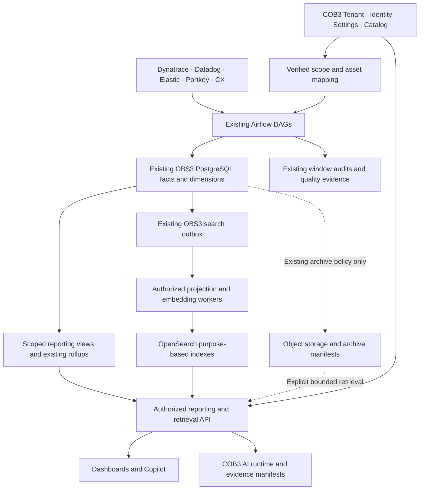

# Observei — Live Telemetry Integration and Additive Schema Design

Version 1.0 · 16 November 2026

**Design status:** reviewable architecture and additive migration contract based on the nine supplied ERDs and the attached COB3 AI/Agent State specification. No database connection was used. No table, data, index, view, DAG or OpenSearch index has been changed. Exact column types, constraints, partitions, view definitions and volumes must be confirmed from PostgreSQL catalogs before generating executable migrations.

## 1. Non-destructive boundary

These schemas contain live customer data populated by Airflow DAGs. They remain the authoritative telemetry stores:

`obs3_aiops`, `obs3_core`, `obs3_cx`, `obs3_incidents`, `obs3_log`, `obs3_ops`, `obs3_search`, `obs3_span`, and the framework-owned `obs3_meta`.

Keep physical schema/table names, current source keys, source field meanings, existing partitions and current ingest contracts. Do not copy these fact tables into new `cob3_*` fact tables. Do not rename, drop, truncate, recreate, repartition or rewrite large tables as part of alignment. Consistency comes from mappings, additive columns, scoped constraints, safe writer changes and reporting/search contracts.

The reusable COB3 schemas own product behavior: tenant lifecycle, Identity authorization, Settings configuration, Catalog resources, Workspace artifacts and AI execution. The existing OBS3 schemas own observed customer telemetry. A Catalog application asset describes a service; it is not a replacement for millions of observations about that service.

OpenSearch indexes and optional embeddings are derived, rebuildable representations, not additional PostgreSQL source tables. They do contain purpose-specific copies of selected content, as any search index does. No second authoritative fact store is proposed. Archival and deletion are separately approved lifecycle operations, not actions implied by this design.

### Correction to the earlier AI-state proposal

The live `obs3_aiops.llm_gateway_call` remains the authoritative imported Portkey/gateway observation table. Do **not** migrate or duplicate its history into the proposed `cob3_llmobs.invocation_attempts` table. Native AI runtime invocations may exist for actual runtime lifecycle/attempt state, but imported observations link to them by verified correlation. A report must select one accounting source for an attempt; it must not UNION and sum both observations as two calls.

The earlier suggestion to coordinate physical prefix renames is deferred for all live telemetry. Existing `obs3_search.outbox` owns telemetry search dispatch. A runtime outbox may carry application workflow events, but the same telemetry change must not be enqueued independently in both systems. An explicit bridge can translate runtime invalidations into the existing search queue once with a deduplication key.

## 2. Target architecture

The diagram describes logical responsibilities, not a mandate to deploy a service for every box. A modular FastAPI backend and existing Airflow workers can implement the first phase. PostgreSQL serves authoritative reporting; OpenSearch serves keyword, filtered and optional vector retrieval. AI requests use the same authorized APIs as human requests.

**Storage placement:** transactional app state remains in COB3 PostgreSQL schemas; customer telemetry stays in its current OBS3 tables; search documents live in OpenSearch; embedding caches remain derived; existing bronze/archive objects remain at their current object-store locations. ClickHouse is not required by this migration. Adding another analytical store later needs a separate capacity/ownership decision and must not become an accidental third source of truth.

## 3. Scope and identity reconciliation

### 3.1 Preserve numeric tenant IDs

ERD icons suggest numeric tenant IDs in many telemetry tables; verify actual types. Foundation tenant and organization IDs are UUIDs. Do not cast or replace the old tenant_id in place.

| Situation | Additive treatment |
|---|---|
| Existing tenant_id already matches canonical UUID/type/meaning | Reuse it; do not add another canonical tenant column |
| Existing tenant_id is numeric/text or a legacy namespace | Preserve it; add `platform_tenant_id uuid` as canonical FK |
| No tenant field on customer-scoped base table | Add `tenant_id uuid`, initially nullable, as canonical FK |
| Organization missing | Add `organization_id uuid`, initially nullable |
| Existing organization field has another type/meaning | Preserve it; add `platform_organization_id uuid`; expose canonical name through view |
| Multi-tenant infrastructure/control row | Keep explicitly platform-scoped; do not invent a customer organization |
| Ordinary view | Expose scope through its query; do not ALTER it as if it stored rows |
| Materialized view lacking scope | Do not fabricate scope after aggregation; use correctly scoped base queries until a separate projection evolution is approved |

For brevity, `canonical_tenant` and `canonical_org` below mean the appropriate physical columns from this table. Public APIs and new reporting views expose canonical UUIDs as tenant_id/organization_id and legacy tenant_id separately as legacy_tenant_id.

A static organization value is safe only if a verified source connection/stream historically and currently belongs to exactly one organization. A whole source system such as Datadog or Elastic is not an organization mapping. One provider account may contain multiple organizations. Use explicit selectors, for example provider account plus dataset/environment/application mapping, and reject ambiguous matches. Never guess scope from email, host naming, free-form team or default tenant.

Unresolved rows remain in place and are excluded from customer reports/search. Continue ingesting them with an unresolved/review status; expose coverage gaps through restricted ingestion diagnostics. No data is deleted. Mapping history must distinguish event-time ownership from processing time; moving an app today does not silently reassign past customer data.

### 3.2 One small mapping relation, only if no equivalent exists

Reuse an existing validated mapping relation if inspection finds one. Otherwise add **one control table**, `obs3_core.source_scope_binding`. This is not a duplicate telemetry table. It documents how a legacy/source namespace resolves to canonical scope. No new entity/asset master is introduced.

| Column | Type | Contract |
|---|---|---|
| scope_binding_id | uuid | PK; generated for a new mapping |
| tenant_id | uuid | NOT NULL; canonical Tenant FK, despite legacy facts using numeric tenant_id |
| organization_id | uuid | NOT NULL; composite canonical organization FK |
| created_at | timestamptz | NOT NULL DEFAULT now(); immutable |
| created_by | varchar(160) | NOT NULL; trusted namespaced actor |
| updated_at | timestamptz | NOT NULL DEFAULT now() |
| updated_by | varchar(160) | NOT NULL; trusted namespaced actor |
| metadata | jsonb | NOT NULL DEFAULT '{}'; bounded object, no secrets |
| row_version | bigint | NOT NULL DEFAULT 1; positive optimistic version |
| source_connection_id | uuid | NOT NULL; existing/proposed connector connection FK, adapter resolves its canonical tenant/org |
| legacy_tenant_key | text | NOT NULL; exact original typed representation using a documented canonical serializer |
| stream_key | varchar(200) | NOT NULL; controlled source collection/account stream |
| selector_key | varchar(300) | NOT NULL; deterministic approved selector, no arbitrary SQL |
| valid_from | timestamptz | NOT NULL; inclusive event-time boundary |
| valid_until | timestamptz | NULL; exclusive boundary |
| mapping_version | integer | NOT NULL; positive |
| status | varchar(20) | NOT NULL; draft, active, retired |
| approved_by_principal_id | uuid | NULL until activation; authorized Identity principal |
| approved_at | timestamptz | NULL until activation |

Expose UNIQUE(tenant_id,organization_id,scope_binding_id). For active mappings, prohibit overlapping effective ranges for the same connection/legacy key/stream/selector. One record maps one deterministic scope; broad and narrow selectors must be proven disjoint or evaluated by an explicit resolver that fails on more than one match. Mapping content is immutable once referenced; retire and create a version for corrections. Active requires approver/time. FK plus validator ensures connection and mapping belong to the same canonical scope. Shared provider accounts use separately scoped logical connector connections, not duplicated imported data.

Telemetry rows may carry `scope_binding_id uuid` for exact provenance. Its scoped FK proves the canonical tenant/org match. Scope changes require controlled remapping and search invalidation, not ordinary upsert mutation. A new mapping must not make unrelated legacy rows visible.

### 3.3 Catalog integration without another master

- Preserve dim_application.app_sk and source app_id. Add `catalog_asset_id uuid` to dim_application where a unique scoped relationship is established.
- Preserve dim_application_environment.app_environment_sk and relate it to the same canonical scope/application. This dimension is a telemetry reporting dimension, not the AI-application configuration table.
- Preserve dim_monitored_entity, dim_service, dim_resource and host/source dimensions. Add Catalog references only for durable governed entities where useful. Do not create one Catalog asset for each log, trace or metric sample.
- Extend existing entity_alias and service_alias with source connection, organization and effective mapping evidence. Keep current source names/IDs unchanged. Unknown/ambiguous aliases are not accepted as authoritative.
- Source service/application, environment and host identifiers are scoped by connection, tenant and organization. Global string joins on service_name/app_id/host_name are prohibited.
- Event authorization normally follows the governed application/datasource asset and current Identity permissions. Domain/team labels are for attribution; they are not permissions embedded in event text.
- Cross-application incidents can reference several assets. Broad incident detail is visible only under the configured rule covering all included sensitive assets, or through an explicitly redacted authorized projection. Permission to one affected app must not expose every other app's evidence.

## 4. Mandatory columns: logical consistency with physical restraint

Preserve the mandatory design contract: tenant_id, organization_id, created_at, created_by, updated_at, updated_by, metadata and row_version. On live telemetry, first map existing equivalents and add only what is missing. Do not redefine an existing created_at source-event timestamp to mean database insertion time.

| Canonical field | New-column type | Existing-data treatment |
|---|---|---|
| tenant_id | uuid | Resolve as Section 3; legacy numeric field remains |
| organization_id | uuid | Initially nullable; only verified mapping fills it |
| created_at | timestamptz | Reuse true record creation field; otherwise add record_created_at if created_at already means source time |
| created_by | varchar(160) | Ingestion service principal/system audit actor, not the customer who generated a log |
| updated_at | timestamptz | Reuse true mutation timestamp; add record_updated_at if name conflicts |
| updated_by | varchar(160) | Trusted writer identity; not last_comment_author or external incident owner |
| metadata | jsonb | Small extension object; attributes/raw_payload/source_payload retain original meaning |
| row_version | bigint | Positive row-change generation; stable on no-op retry |

Physical audit additions start nullable with no fabricated historical default. New writers populate them. For historical data, reuse ingested_at only if its meaning supports database creation; retain an explicit inferred/unknown provenance flag in migration diagnostics. Never backfill all created_at to the migration date and claim it was event creation time. A current backfill updated_at honestly describes migration mutation, while source_updated_at/source event timestamps remain unchanged.

Tables without conflicting fields can receive the exact mandatory names. Views expose a consistent canonical naming contract. This avoids eight unnecessary copies of already equivalent values while retaining audit consistency. Derived views do not store audit columns; materialized aggregates have refresh/build provenance, not fictitious row creators. Append-only observations keep creation/update fields equal until a genuine correction; mutable incident/alias/cursor/outbox rows increment row_version on real change.

**Explicit exceptions:** obs3_meta.alembic_version remains untouched. Platform partitioned_table/archive_log and global search family/settings definitions may describe multiple tenants; they remain restricted platform control-plane records. Do not impose a fake NOT NULL organization on them. New customer-scoped control definitions include all mandatory columns; platform registry scope is explicit, with tenant/org NULL only where genuinely global.

Additional columns are selected by need, not stamped indiscriminately on every large row:

| Field | Type | Applies when |
|---|---|---|
| scope_binding_id | uuid | Mapping evidence for scoped base facts/dimensions |
| source_connection_id | uuid | Existing source_system does not identify provider account/connection |
| catalog_asset_id | uuid | Direct event asset lookup is justified; otherwise use scoped dimension join |
| source_updated_at | timestamptz | Provider exposes reliable update ordering |
| source_revision | text | Provider version/ETag; opaque, not lexically sorted unless adapter guarantees it |
| scope_status | varchar(20) | resolved, unresolved, conflict; defaults only for new writer behavior |
| observation_kind | varchar(30) | snapshot, event, aggregate; useful when source semantics differ |
| is_deleted | boolean | Provider tombstones needed for mutable source records; not a blanket purge flag |

Existing run_id in telemetry is an ingestion/DAG correlation unless verified otherwise. Never reinterpret it as an AI run UUID. Add `ai_run_id uuid` only to verified correlated rows; use ingestion run references for ETL audit and execution principal separately.

## 5. Screenshot-by-screenshot preservation and mapping

Table/view classification below follows visible naming and ERD icons; PostgreSQL relkind is authoritative. All unchanged fields remain. These are delta instructions, not replacement CREATE TABLE definitions.

### 5.1 obs3_aiops — Portkey/gateway metrics

| Existing object | Treatment |
|---|---|
| llm_gateway_call | Keep PK and source_call grain; add canonical scope/connection and missing audit contract; retain call_id, trace_id, source_record_key and usage/cost fields |
| v_llm_gateway_daily | Expose/group canonical tenant/org and environment; use scope-safe base rows, not an existing mixed aggregate |

Document whether call_id represents a logical request or provider attempt for each source adapter. Add optional logical_request_id text, provider_request_id text and attempt_number integer only when the provider supplies evidence. Preserve missing usage as unknown. Cache/reasoning token fields may be subsets, not additive totals. Currency is a dimension; never sum different currencies into cost_usd without a versioned conversion rule. Keep cost provenance: estimated, source-reported or reconciled. Native runtime correlation uses IDs and exact source references, not copied telemetry rows.

### 5.2 obs3_core — shared telemetry dimensions

| Existing object | Treatment |
|---|---|
| dim_application | Retain app_sk/app_id/app_name; add canonical scope, source connection and catalog_asset_id where resolved |
| dim_application_environment | Retain app_environment_sk/app_sk/environment; add matching scope, ensure parent application scope agrees |

A dimensional ID can remain numeric while the Catalog asset ID is UUID. No need to rewrite every app_sk FK. Historical ownership belongs to mapping evidence; reporting current app names versus event-time names must be an explicit choice.

### 5.3 obs3_cx — customer experience

| Existing object | Treatment |
|---|---|
| customer_survey | Keep id/source_response_id/survey_id and source fields; add canonical scope and missing audit fields; restricted access to comments, replay URLs and identifiers |
| cts_survey_responses | Query base rows with scope carried through every transformation; preserve source response identity |
| cts_survey_scored | Carry scope, source id and scoring/rules version; distinguish model-derived sentiment from raw survey values |
| cts_mv_daily_scores | Group scope + local_date + web_nonweb + customer_type + is_curated |
| cts_mv_hourly_scores | Group scope + bucket_hour + dimensions currently used |
| cts_mv_drivers | Group scope + local_date + level_1/level_2 + existing segments |
| cts_mv_sentiment_daily | Group scope + local_date + sentiment_label + existing segments |
| cts_mv_variance_heatmap | Group scope + local_date + taxonomy levels + segments |
| cts_mv_reason_summary | Group scope + local_date + reason_for_visit + existing taxonomy/segments |

The materialized view names do not prove their SQL definition. If already mixed across organizations, their results cannot be secured by attaching a tenant/org label afterward. Preserve the objects, restrict their multi-tenant exposure, and route new customer reports through bounded scoped queries of customer_survey/scored base data. Altering a materialized view's query generally needs a separate evolution plan; no drop/recreate is authorized here. New replacement stored aggregates are not part of this phase.

For averages preserve denominator/count of non-NULL scores and score_sum; average(avg_score) is wrong across unequal groups. If only avg_score and volume exist, verify volume equals the score denominator before weighted combination. Combined variance requires count, sum and sum of squares or equivalent mergeable state, not average variance. Percentiles cannot be reconstructed from group averages. Version taxonomy, sentiment/scoring rules and timezone definitions; report local_date from documented source timezone, retaining event instant for correlation. Do not reinterpret customer session IDs as Identity principal IDs.

### 5.4 obs3_incidents — incidents, events, alarms and evidence

| Existing objects | Treatment |
|---|---|
| incident | Keep composite source identity/event_date; add canonical scope and provider update ordering; define whether rows are snapshots or one mutable incident |
| incident_event | Preserve separate event grain; scoped parent/correlation mapping; do not count it as another incident |
| incident_entity | Scoped bridge; verify entity and incident both belong to same scope; role remains part of grain |
| incident_evidence | Preserve evidence_sk and source references; restrict evidence to allowed incident/asset context |
| alarm | Preserve alarm_unique_id and source system; optional incident link is correlation, not guaranteed identity |
| dim_monitored_entity | Preserve entity_sk; add scoped connection/Catalog binding |
| entity_alias | Add scope/connection and mapping provenance; prevent same alias resolving ambiguously |
| window_audit | Keep ingest-window measurements; distinguish pipeline-wide vs organization-scoped coverage |
| v_incident, v_alarm | Secured canonical read interfaces; preserve original fields |
| v_incident_application, v_incident_event_link | Include all scope and source keys in joins; prevent multiplying incident totals |
| v_incident_log_signal, v_incident_span_signal | Correlate within scope, time bounds and resolved assets; label heuristic matches |
| v_app_coverage_daily | Per-scope counts, mapping coverage and completeness |

Canonical incident business identity includes connection + source + vendor incident ID; event_date may be a storage/snapshot key. Count distinct business incidents for incident counts, latest valid snapshot for current open counts, and unique transitions for lifecycle metrics. Do not sum duration_s across snapshots. Preserve start/end timestamps and distinguish currently open age from resolved duration. Add normalized status/severity only as derived versioned mappings; retain status_raw and provider severity.

Late reopen/update must win according to source revision/time, not arrival order. For ties/missing source versions, use an adapter-documented deterministic reconciliation policy and expose ambiguity. Joining entities/evidence to incidents can multiply rows; aggregate each child to the desired incident grain first or use EXISTS filters. MTTR definitions must state closure/reopen handling, excluded incidents, timeframe and units. Source suppression/maintenance flags are meaningful reporting dimensions, not invisible deletions.

### 5.5 obs3_log — Elastic-derived logs and rollups

| Existing objects | Treatment |
|---|---|
| log_event | Preserve log_id/event_date and es_index/es_id; scope + connection; retain timestamps, correlation and bronze pointers |
| log_error_detail, log_flowstack | Inherit exact parent scope and full log key, including date; depth remains flowstack grain |
| deployment_event | Preserve event_id/date and source; scope application/host/component references |
| log_volume_minute | Preserve source population doc_count; scope plus original dimensional grain |
| dependency_call_minute | Preserve counts/status/endpoint grain; do not sum with raw log-derived counts of same population |
| log_template_minute | Preserve total/kept/suppressed; scope every grouping key |
| dim_log_file, dim_error_type, dim_component | Add/validate scope and source namespace; retain existing surrogate keys |
| dim_endpoint, dim_log_source, dim_host, dim_log_template | Same; templates include parser/rules version and classification |
| v_log_event, v_volume_minute, v_dependency_minute, v_template_minute, v_new_templates_24h | Scope-safe queries; no global template/sample snippet leakage |

Use source connection + Elasticsearch index identity + document ID as deduplication evidence where reliable; source document IDs alone are not globally unique. Preserve existing internal keys. Log replay can update an observed record; ensure row_version changes only if source content or derived classification changes.

Prefer one search document for a retained multiline log with structured stack/error fields. Do not index every flowstack depth as another occurrence and then count documents as log volume. Keep event_ts, es_ts, ingested_ts/ingested_at and ship_lag_ms meanings distinct. Negative lag/clock skew is a quality signal, not automatically zero. Normalize units through views without changing raw values. Avoid embedding raw every-line logs; templates, unusual error signatures and curated incident evidence offer better semantic units.

### 5.6 obs3_span — Datadog traces/spans and changes

| Existing objects | Treatment |
|---|---|
| span_event | Preserve span_uid/source/date key; add scope/connection; validate trace/span/parent IDs and duration unit |
| change_event | Preserve independent operational change grain; scoped asset correlation |
| span_rollup_minute | Preserve grain/resource/service/status and source metrics; add scope where unambiguous |
| span_signature_minute | Preserve total/kept/suppressed; scoped signature/service/app/host grouping |
| dim_service, dim_resource, dim_error_signature | Preserve surrogate keys; scope + provider connection; optional Catalog binding |
| service_alias | Add org/connection/resolver version; same service_name may occur in multiple accounts/environments |
| window_audit | Preserve audit; report truncation, capped rollups and missing context |
| v_span_event, v_change_event | Scope and declared units in secured views |
| v_service_minute, v_resource_minute, v_signature_minute, v_new_signatures_24h | Scope every group; do not reaggregate p95/p99 as averages |
| v_span_log_link | Scoped trace identity + source linkage; label exact vs heuristic correlations |

A span ID may be unique only within a trace/source; span_uid must have documented derivation. Normalize comparisons using trace_id + span_id + connection/scope when applicable. Do not force vendor IDs into an OpenTelemetry format by truncation. duration_ns remains nanoseconds; views may expose duration_ms = duration_ns / 1000000.0. Percentiles in span_rollup_minute are provider-window statistics; they cannot produce a true longer-window percentile without histograms/raw population. Raw spans may be sampled or selected for errors. Observed error/span counts are not automatically population error rates. Expose sampling/truncation/completeness fields from window audit and provider policy.

### 5.7 obs3_ops and obs3_meta — operational control

| Existing objects | Treatment |
|---|---|
| obs3_ops.window_audit | Keep Elastic ingestion window counters/timings and source run_id |
| obs3_ops.dynatrace_window_audit | Keep provider-specific problems/events/entities completeness |
| obs3_ops.datadog_window_audit | Keep spans/context/rollup/changes completeness |
| obs3_ops.migration_audit | Keep existing migration evidence; add mapping/backfill checkpoint notes if compatible |
| obs3_ops.partitioned_table | Platform physical-table retention registry; not a customer fact |
| obs3_ops.archive_log | Physical partition/archive manifest evidence; no duplicate archive registry |
| obs3_meta.alembic_version | Leave framework-owned table entirely unchanged |

Audit tables with keys such as tenant_id/source_system/window_start may describe a whole tenant window spanning several organizations. Do not assign one arbitrary org to that total or replicate totals per organization. Keep platform/tenant-level audit access restricted, and emit org-specific completeness through per-scope DAG metrics only where current key grain supports it. If separate rows would collide, constraint/key evolution must precede enabling them.

Several screenshots show similar window audit structures in different schemas. Do not consolidate or duplicate their rows. Designate the authoritative audit object for each DAG from actual code and expose a canonical union/report view with source_table + pipeline/run key and explicit dedup rules. Distinguish the same audit repeated by a compatibility view from independent pipeline observations.

Archive metadata is not authorization to drop a partition. A partition can contain multiple tenants/orgs; a hold for one retained record may prevent dropping the whole partition. Preserve the current policy until archive correctness, hold checks and restore tests are separately reviewed.

### 5.8 obs3_search — reuse the existing indexing framework

| Existing object | Additive improvement |
|---|---|
| family | Keep registry; add projection_version integer, mapping_version integer, scope_mode varchar(20), retention_class varchar(50), embedding_model_version varchar(200) NULL, classification varchar(30) as needed |
| outbox | Retain id and source fields; add scope, source connection, immutable event_key, document revision, delivery state/lease fields and target generation where missing |
| outbox_dlq | Preserve source event identity/revision/scope and failure context; replay through same dedup path |
| consumer_offset | Retain offset; add projector generation/lease identity and scope/partition only if workers are partitioned; never assume ID allocation equals commit order |
| backfill_watermark | Add bounded source cursor and generation; changed_at alone is insufficient; track tie-breaker PK and reconciliation progress |
| embedding_cache | Scope private content; include content hash + exact model/version + dimension + preprocessing version + use policy; no unrestricted cross-tenant cache hits |
| settings | Keep search engine operational tuning; product preferences stay in COB3 Settings; no secrets in values |
| v_service_synonyms | Tenant/org/connection scoped; aliases must not leak another customer's service names |
| v_doc_entity_app | Application/entity search projection from existing dimensions/Catalog mapping |
| v_doc_incident, v_doc_alarm | Existing operational problem/alarm projections; distinct kinds/IDs |
| v_doc_log_template | Semantic log template projection, preserving rules/parser version |
| v_doc_memory, v_doc_chat_message, v_doc_workspace | Preserve application-resource ACL and source dependency semantics from COB3; do not apply broad telemetry permissions |

Where family or settings rows are globally shared platform definitions, keep them platform-scoped with restricted admin writes. Outbox documents, embedding entries and private search projections are customer-scoped. Add the mandatory audit contract where missing following Section 4; do not duplicate existing updated_at/created_at columns.

## 6. Search document and embedding architecture

### 6.1 Index by retrieval purpose

Reuse current family/alias configuration. The names below are logical families, not an instruction to create all new indexes immediately.

| Family | Authoritative source | Search purpose | Embedding policy |
|---|---|---|---|
| entity_app | Core application/environment and monitored entities with Catalog mapping | Resolve app/service aliases and ownership | Optional short metadata text |
| incident | Incident + scoped evidence/application projection | Find related incidents and grounded RCA evidence | Sanitized incident summary/evidence, versioned |
| alarm | Existing alarms | Alarm lookup and incident correlation | Optional normalized summary |
| log_template | Templates + error classification | Semantic error pattern discovery | Preferred log embedding unit |
| log_event | Retained log_event + authorized error detail | Keyword/correlation/time search | Off by default |
| span_signature | Error signatures + service/resource context | Similar trace failures | Optional normalized signature |
| span_event | Retained span_event | Trace/correlation lookup | Off by default |
| cx_feedback | Authorized survey comments/scored taxonomy | Theme and experience search | Optional redacted text with approved use |
| memory/chat/workspace | Existing application resource projections | Knowledge and saved work retrieval | Their existing ACL/retention policies |

LLM numeric dashboards and minute rollups normally stay in PostgreSQL reporting. Do not index every numeric measure just because OpenSearch is available. Add an LLM search family only for a defined troubleshooting need, with content capture policy enforced.

Use shared indexes with scoped documents for normal tenants, dedicated indexes for justified isolation/scale, and a measured shard budget. One index per small tenant per day causes excessive shard overhead. Time-bucket raw logs/spans; use entity-oriented indexes for mutable incidents/applications. Choose retention from existing policy and volume measurements, not an arbitrary new 35/90-day rule.

### 6.2 Canonical projection envelope

| Field | Type/meaning |
|---|---|
| tenant_id, organization_id | Canonical UUID keywords, required for customer documents |
| family, document_kind | Controlled keywords |
| doc_id | Deterministic hash of scope + connection + family + canonical complete source key |
| source_table, source_pk | Allowlisted table + structured complete key, including date/partition key where applicable |
| source_connection_id | Scoped connector UUID |
| asset_ids | Governing Catalog assets, validated; absence is not public access |
| event_time, observed_time, ingested_time, changed_at | Date fields with explicit UTC meanings |
| source_revision | Positive per-document revision from authoritative mutation/projection state |
| projection_version, rules_version | Exact normalization/template versions |
| content_sha256 | Sanitized indexed content hash |
| classification, access_policy_version | Filtering/invalidation metadata, not self-granted permission |
| trace_id, span_id, correlation_id | Exact-match keywords, source-scoped |
| title, body | Allowlisted/redacted searchable text |
| embedding_model_version, embedding_dimension | Required when a vector exists |
| source_locator | Safe internal identifier; never a bearer/signed URL |

Index mappings explicitly type high-cardinality identifiers as keyword and durations/counters as appropriate numeric types. Avoid dynamic expansion of arbitrary attributes, tags and nested source JSON into thousands of fields; allowlist useful fields and keep other content unindexed or under bounded mapped containers. Verify features against the installed OpenSearch version.

A deterministic doc_id prevents repeated insertion within the same target index. It does not deduplicate across rollover indexes. Route each immutable event to a deterministic event-time partition; late corrections use that same target index. Mutable incidents should stay in an entity index or use a persisted locator to their original concrete index. Do not send every update to the newest rollover write alias and assume the old document is replaced.

### 6.3 Outbox, backfill and deletion correctness

1. A source fact upsert and corresponding search invalidation commit atomically. For high-volume ingestion, enqueue one bounded batch/range invalidation per successful batch where efficient; the projector resolves affected keys. No network indexing inside the ingestion transaction.
2. Workers claim pending queue records with bounded leases. Delivery is at least once; deterministic IDs and monotonic per-document revisions make replay safe.
3. Existing last_outbox_id must not mean “all smaller IDs committed.” Database sequence allocation precedes commit; a smaller ID can commit after a larger one was processed. Poll explicit pending/ack state, or use a commit-ordered CDC cursor. Never permanently skip an uncommitted smaller ID through a high-watermark shortcut.
4. For bulk requests inspect every item, not just HTTP success. Retry transient failures with backoff; DLQ permanent mapping/security failures without advancing their acknowledgement as success.
5. External versioning can reject older updates. Use a real monotonic document generation, not timestamps, lexical provider ETags or a max(row_version) over unrelated joined rows. For multi-table projections, serialize regeneration per doc key and persist a projection generation, or process a single ordered per-key stream that recomputes latest committed state [3].
6. Backfill starts after live change capture is active. Scan stable source key ranges, not OFFSET. Record progress per family/target generation/range; reconcile live mutations and replay caught changes. changed_at + complete PK handles ties for scans, but does not alone guarantee commit-order capture.
7. Deletion/tombstone messages retain source key, scope, concrete index locator and a durable generation beyond old-message replay retention. A source row being absent must generate deletion, not silently return no work. Before replay, recompute live source or tombstone status. Do not rely indefinitely on OpenSearch's deleted-document version retention.
8. Scope reassignment is explicit: revoke visibility, delete old-scope document/cache, then index the authorized new-scope projection. A stale message cannot resurrect the old scope.
9. Initial implementation keeps current indexes and aliases. A future mapping/model revision may need a parallel derived index generation and atomic alias switch; that is a search-index rebuild, not duplication of source tables, and requires its own rollout/capacity plan. Do not execute it under this design task.

Avoid per-log row outbox writes where a batch-range event is sufficient. Measure WAL/queue amplification and projector lag. A mutation must still be discoverable; polling only original event_ts will miss late corrections/deletes. CDC is a later option, not a requirement to interrupt current DAG ingestion.

### 6.4 Authorization must precede aggregation and model context

The API authenticates human/service/automation principals and resolves current Identity grants, organization and permitted assets. It generates filters; clients/agents cannot supply trusted tenant scope or unrestricted OpenSearch DSL. Use network-restricted OpenSearch credentials with least privilege. DLS/FLS can provide additional enforcement; an alias filter alone is not a security boundary [4].

Enforce tenant/org and resource permissions **before** search aggregations, suggestions, facets, snippets and result counts. Filtering the top hits afterward does not prevent information leakage through counts or aggregates. Final source-access verification protects content loading and LLM context but cannot fix an already leaked count. If fine-grained live authorization cannot be expressed for a requested aggregate, deny it or compute it from an authorized source query.

Preserve current credential/grant ceiling on AI retrieval; infrastructure indexer credentials do not become the agent's business permissions. Cross-org retrieval is a separately authorized server-side federation of scoped queries, not an unfiltered wildcard query.

Memory/chat/workspace data and sensitive CX feedback require their own policies. Application telemetry read does not imply private chat, personal memory or survey verbatim access. Global embedding reuse for private text is disabled; tenant/org/use-policy-aware cache keys and source rechecks are required. Embedding similarity is evidence of relevance, not authorization.

## 7. Reporting contracts and grain

Every dataset/view documents: row grain, business key, event-time field, source update ordering, population, units, scope, lateness policy and coverage. Keep source facts and derived records distinguishable.

| Reporting requirement | Authoritative path | Critical rule |
|---|---|---|
| Current incidents | Latest valid incident observation per scoped business ID | Deduplicate snapshots before count |
| Incident trends/MTTR | Source lifecycle times/events with specified reopen policy | Not count of evidence/entity joins |
| Log volume | log_volume_minute/source window totals | Retained error log count is not full source volume |
| Log diagnostics | log_event/error_detail/flowstack | One multiline event, many detail rows |
| Service latency | span_rollup_minute at its provider window | p95/p99 cannot be averaged into longer percentiles |
| Trace investigation | span_event and scoped trace/log links | Sampling and missing parents explicitly shown |
| CX satisfaction | Scoped customer_survey/scored projection | Correct score denominator and local timezone |
| LLM usage/cost | llm_gateway_call with adapter-defined grain | Retries/currency/unknown usage are explicit |
| Pipeline health | Designated source window_audit | Truncation/unparsed/capped windows lower completeness |
| AI answer evidence | Authorized source IDs/versions and runtime context | Retrieval result is not a new source fact |

For each published dashboard return data_through/event watermark, last_successful_ingest, mapping coverage, missing/truncated windows and freshness. Data coverage percentage differs from ingestion success. A successful API request may be truncated and a successful DAG may have dropped unmatched rows. Do not show such a window as complete.

Rollups must include canonical scope in their grain. If an old aggregate irreversibly combines organizations, do not backfill a fabricated org. Compute the scoped metric from available base population, or mark unavailable when the retained base is only a sample. No assumption that suppressed raw events can be reconstructed.

Date predicates use [start,end) and explicit timezone boundaries. Preserve source event_date/partition conventions; changing them in place can move rows across partitions. Incidents spanning midnight remain one business incident unless a report explicitly asks for daily snapshots.

## 8. Additive live migration sequence

### Step 0 — inventory and baseline

Read actual pg_class relkind, pg_attribute types/defaults, constraints/indexes, partition hierarchy, view/MV definitions and dependencies, grants/RLS, triggers and Airflow upsert SQL. Capture table/index sizes, ingest rate, update rate, long transactions, WAL/replica lag, free disk, autovacuum health and current count/latency baselines. Reuse existing observability and audits. Do not run full-table profiling in peak hours without bounds.

Confirm every target's complete PK and ON CONFLICT target. Adding organization_id does not extend an old uniqueness constraint automatically. Two organizations may still collide under an existing tenant/source/external-ID key. Before onboarding a colliding scope, plan a concurrent expanded unique index and dependency-aware key/constraint migration. Do not drop the PK casually; old conflicting unique indexes may also block inserts. Until that is safely resolved, reject the unsupported source combination instead of corrupting data or overloading source_system with hidden org suffixes.

### Step 1 — source mapping and writer compatibility

Approve the source-to-scope mapping. Ensure Airflow uses explicit INSERT/COPY column lists; adding columns breaks positional imports or row unpacking assumptions. Deploy code compatible with both old and new columns, gated until additions are present. Verify connection-scoped service principal/grant checks. Never trust an organization supplied by a source payload without validation.

### Step 2 — add missing nullable columns in short transactions

Add only verified missing fields, with no backfill/default expression that rewrites the table. PostgreSQL ALTER TABLE still needs locks even for metadata-only changes [1]. Set short lock_timeout, bounded statement_timeout, retry with backoff off-peak and abandon the attempt if blocked; do not queue DDL indefinitely behind a long transaction. Inspect partition descendants and inheritance before altering a parent. No DROP/CREATE replacement.

Examples are **patterns, not an executable migration**: ADD COLUMN organization_id uuid; ADD COLUMN platform_tenant_id uuid where numeric legacy tenant_id exists. IF NOT EXISTS does not prove an existing column has the right type/meaning. Inspect first. Avoid adding generated UUID defaults to every historical row or broad NOT NULL constraints in the same step.

### Step 3 — new writes first

Enable verified scope/audit writes on new data and updates. Keep original keys/source timestamps unchanged. Reject/quarantine unresolved mappings from customer-serving surfaces while retaining ingestion data. Verify all writers, including manual replay and repair jobs. Scope-aware views can serve only resolved rows before all history is backfilled.

### Step 4 — bounded historical backfill

Process one bounded partition/key range at a time using indexed stable keys. Small committed batches, resumable high-watermarks per range, rate limits and pause thresholds for replica lag/WAL/disk/ingestion latency. No unbounded UPDATE of every historical row in one transaction. UPDATE only rows still unresolved and only when mapping matches the event-time/source key; compare row_version/source revision to avoid overwriting concurrent DAG corrections. Bulk scope-only updates must not reset provider source_updated_at.

Backfill produces dead tuples/WAL even when no table rewrite occurs. Budget disk for WAL, bloat and new indexes; allow normal vacuum to recover space. Do not use VACUUM FULL, CLUSTER or table-copy swap as routine cleanup in this change. Never use ctid as a durable resume cursor across transactions.

### Step 5 — indexes and constraints gradually

Build only needed scoped read/FK indexes; evaluate BRIN for append-correlated time scans and B-tree for scoped selective ranges. Avoid indexing every new column. On ordinary tables CREATE INDEX CONCURRENTLY avoids blocking ordinary writes but still consumes resources, waits and may leave invalid indexes on failure; it cannot run inside a normal transaction block. On partitioned tables use a version-appropriate per-leaf concurrent build and parent attachment plan [2].

Once new writes comply, add scoped FKs/CHECKs NOT VALID where supported, then VALIDATE in bounded operational windows. NOT VALID still checks new rows/updates, so premature introduction can break live ingestion. Partitioned constraints have version-specific restrictions; verify before scripting. A validated non-NULL check can support a later NOT NULL change, but locks still need budgeting. Do not declare production constraints validated based on screenshot assumptions.

### Step 6 — reporting and search cutover

Introduce ordinary secured adapter views or append compatible columns to existing views only where dependency rules allow. New ordinary views do not duplicate stored facts. Retain legacy views for compatible trusted consumers; remove customer exposure to unscoped aggregates through a coordinated API rollout, not an unannounced global permission change. Use base scoped queries for MVs that cannot be altered without replacement.

Run search backfill alongside live queue capture with lower priority than ingestion. Compare scoped counts/source keys, sample content and delete/replay behavior. New reports show completeness and do not blend old mixed aggregates. Match reported totals to the exact source population, not an arbitrary raw retained subset.

### Step 7 — verify and retain rollback

Feature flags revert new readers/writers to compatible behavior; leave additive columns/indexes in place if rollback is needed. Do not “rollback” by dropping populated columns. Preserve backfill checkpoints and mappings for investigation. No original table is removed at completion. Any future repartitioning, stored aggregate replacement, index generation replacement or archive purge is a separate change with explicit scope.

## 9. Acceptance gates

- Wrong tenant/org/source mapping cannot enter a customer-facing view or search result.
- Source ID collision tests cover two orgs and two connections before expanding ingestion coverage.
- Airflow retry of an already committed batch does not duplicate facts, rollups or search documents.
- Old provider updates do not revert a closed/reopened incident or newer source correction.
- Backfill cannot overwrite a concurrent valid scope assignment or source update.
- Scope added to rollup grain reconciles exactly where complete base data exists; otherwise report unavailable/incomplete.
- Incident joins do not multiply counts; multiline logs do not inflate volume; sampled spans do not masquerade as population rates.
- OpenSearch bulk partial failure, out-of-order delivery, delayed lower outbox ID commit, rollover update and delete/replay are tested.
- Cross-tenant search hits, facets, autocomplete, aliases, embedding cache and snippets reveal no data.
- Source revocation/deletion blocks AI context and stale cached summaries before reindex finishes.
- Legacy framework and platform control tables continue operating without invented customer scope.
- WAL, replica lag, ingest throughput, P95 report latency and queue lag stay within measured deployment thresholds; thresholds are set from baseline before rollout.
- Archive/hold/restore policy remains unchanged by this migration; no partition drop is part of acceptance.

## 10. Implementation deliverables after database inventory

Generate per-object additive migration scripts, not a fresh installer: exact ADD COLUMN operations, backfill workers, separately executed concurrent indexes, staged constraints, compatible DAG writer changes, secured reporting-view SQL and existing search-family configuration amendments. Include dry-run/inventory output, retry/pause conditions and reconciliation queries. No destructive DDL, mass renaming, duplicate source tables or automatic archive deletion belongs in those scripts.

This document is the architecture and mapping contract. The attached screenshots do not provide enough information to promise a safe copy-paste migration against live data. A schema-only export plus existing DAG upsert SQL and current OpenSearch mappings supplies the remaining implementation evidence without needing customer payloads.

## Technical references

[1] PostgreSQL ALTER TABLE — locking, defaults and staged constraint validation: https://www.postgresql.org/docs/current/sql-altertable.html

[2] PostgreSQL CREATE INDEX and partitioning — concurrent build restrictions and partition index attachment: https://www.postgresql.org/docs/current/sql-createindex.html and https://www.postgresql.org/docs/current/ddl-partitioning.html

[3] OpenSearch Bulk API — per-item outcomes and external version checks: https://docs.opensearch.org/latest/api-reference/document-apis/bulk/

[4] OpenSearch authorization and document-level security — enforce authorization rather than treating aliases as isolation: https://docs.opensearch.org/latest/security/access-control/authorization-basics/ and https://docs.opensearch.org/latest/security/access-control/document-level-security/

These references support implementation mechanics. All naming, ownership, scope mapping and rollout choices are proposed for Observei and must be matched to installed versions and actual existing constraints.
