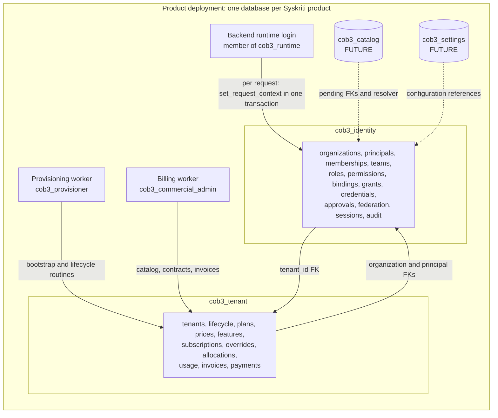

# Implementation decisions and design reconciliation

Foundation version **1.0.0** · implements `COB3_Tenant_Schema_Summary_v1.md` (Tenant, 21 tables) and
`COP3_Identity_Consolidated_Schema_v1.md` (Identity, 27 tables) under the scope rules of
`Syskriti_SaaS_Foundation_Claude_Code_Master_Prompt.md`. The three source files are unchanged.

## 1. Scope of this delivery

Delivered: the PostgreSQL foundation (`database/syskriti_foundation/`): standalone installer, verify
report, bootstrap example, seeds, Catalog integration contract/template, 52 executed tests, and these
documents. **Not delivered in this pass:** the Python/FastAPI backend package (section 8 of the master
prompt). The SQL routines below are the product-independent service boundary that backend services will
wrap; nothing in the database depends on a backend existing.

## 2. Architecture

| Schema | Responsibility | Status |
|---|---|---|
| `cob3_tenant` | Tenant master/lifecycle, platform commercial catalog, subscriptions, entitlements, quota allocation, usage, billing mirror | Implemented |
| `cob3_identity` | Organizations, principals and subtypes, memberships, teams, RBAC, grants, credentials, approvals, federation, sessions, audit | Implemented |
| `cob3_catalog` | Domains and governed assets | Future; contract in `future_integrations/` |
| `cob3_settings` | Preferences, integration/secret references, policies | Future; backend defaults meanwhile |

## 3. Naming reconciliation

| Source name | Implemented | Note |
|---|---|---|
| `cop3_identity.*` (Identity doc) | `cob3_identity.*` | All 27 tables, same table/column names |
| `cop3_tenant.tenants` (Identity doc FK target) | `cob3_tenant.tenants` | Same key shape `tenant_id uuid` |
| `cob3_tenant.*` (Tenant doc) | `cob3_tenant.*` | All 21 tables |
| `cop3_catalog`, `cop3_settings` | `cob3_catalog`, `cob3_settings` (future) | Not created |

The repository contained no existing schema, ORM or migrations (only the three specification files), so
no `cop3_*` objects exist to migrate; this is a fresh installation and no rename/migration strategy is
needed. Schema names are resolved literals in all SQL; `build_installer.py` holds the single tooling
constant `SCHEMAS = ("cob3_tenant", "cob3_identity")`.

## 4. Row ownership scopes

| Category | tenant_id | organization_id | Tables |
|---|---|---|---|
| Platform catalog | must be NULL (CHECK) | must be NULL | plans, plan_versions, features, plan_entitlements, plan_prices |
| Tenant root | PK | must be NULL | tenants |
| Tenant-owned | NOT NULL | must be NULL (CHECK) | tenant_contacts, lifecycle events, provisioning_jobs, billing, subscriptions/periods/changes, overrides, invoices, lines, payments, provider_events; Identity: principals, user_profiles, permissions, roles, role_permissions, tenant_role_bindings, identity_providers, external_identities, external_groups |
| Organization-owned | NOT NULL | NOT NULL | organization_quota_allocations; Identity: organizations, service_accounts, automation_profiles, memberships, teams, team tables, access_scopes, role_bindings, grants, entries, credentials, bindings, approvals, group_team_mappings |
| Organization-attributed / context | NOT NULL | nullable (validated FK when set) | usage_events, usage_rollups, auth_sessions, audit_events |

NULL is never a wildcard: platform rows have their own policies (runtime reads only active/published
rows with an authenticated context; only `cob3_commercial_admin` writes). Tenant-owned IAM seeds are
created **per tenant** by `provision_tenant_iam_seed` — never with a NULL or made-up tenant.

## 5. Keys, composite FKs and the two UUID conventions

The documents use different key conventions; both are preserved because each supports its document's
isolation guarantees:

* **Tenant tables:** `PRIMARY KEY (entity_id)` plus `UNIQUE (tenant_id, entity_id)`; children reference
  `(tenant_id, entity_id)`. Platform catalog references use the global id.
* **Identity tables:** `PRIMARY KEY (tenant_id, entity_id)`; organization-owned tables also expose
  `UNIQUE (tenant_id, organization_id, entity_id)`.

Additional parent UNIQUE keys required by compound references were added exactly as the specs describe:
`authorization_grants (tenant, org, grant, grantee)` (credentials, sessions, approval requester),
`authorization_grant_permissions (tenant, org, grant, entry)` (credential bindings, approvals),
`principal_credentials (tenant, org, grant, credential)` (bindings, sessions),
`external_identities (tenant, external_identity_id, principal)` (sessions),
`payment_transactions (tenant, invoice, transaction)` (same-invoice reversals),
`plan_prices (plan_version_id, plan_price_id)` (contract segments). All 128 FKs are
`ON UPDATE/DELETE RESTRICT` and covered by an index (verified).

## 6. Circular references and bootstrap order

* Tenant → Identity: `tenants` has no Identity FK (actors are strings like `system:bootstrap`); Tenant
  tables that reference organizations/principals get their FKs after both schemas exist.
* Principal ↔ subtype: subtype rows FK to `principals`; "exactly one matching subtype" is a
  **deferred constraint trigger** checked at commit.
* Service/automation ↔ own membership: `*_self_membership_fk` are **DEFERRABLE INITIALLY DEFERRED** FKs,
  so principal, membership and subtype can be inserted in any order within one transaction.
* Tenant status ↔ lifecycle event: a deferred constraint trigger requires an event for every status
  change in the same transaction.
* Bootstrap = `bootstrap_tenant` (one transaction, `cob3_provisioner` only): tenant (provisioning) →
  IAM seed → organization + organization scope → human principal/profile/membership → tenant
  administrator + organization administrator bindings → activation. RLS stays enabled; the routine
  refuses tenants that are not `provisioning` or already have an administrator.

## 7. Where each class of invariant is enforced

| Invariant class | Mechanism |
|---|---|
| Tenant/org matching, existence | Composite FKs + NOT NULL + scope CHECKs |
| Enumerations, XOR recipient, date ordering, monetary arithmetic, digest lengths | Named CHECK constraints |
| Uniqueness incl. "one live subscription", "one active delegated grant", primary contacts | UNIQUE / partial unique indexes (static predicates only) |
| No overlapping windows | `btree_gist` EXCLUDE constraints (periods, approved overrides, active allocations) |
| Subtype, role class, creator/owner, membership type, grant shape, credential usage | Validation triggers + immutability of the referenced attribute |
| Immutable envelopes and snapshots | Generic `tg_freeze_columns` / `tg_immutable_columns` + state machines |
| Append-only history | `tg_append_only` + `tg_block_truncate` + `row_version = 1` CHECK + no runtime privilege |
| Hierarchy acyclicity | Advisory lock per tenant/org + `FOR SHARE` ancestor walk |
| Quotas, allocations, usage counters | Advisory or row locks, then fresh-snapshot reads; REPEATABLE READ refused (`SKISO`) |
| Exactly-once approval consumption | Single conditional `UPDATE … WHERE status='approved' AND digest=…` |
| Who may mutate IAM | RLS WITH CHECK calling `evaluate_access`; high-risk tables writable only via SECURITY DEFINER routines |
| Live authorization | `cob3_identity.evaluate_access` (interactive RBAC; grant ∩ grantor ∩ grantee ∩ credential subset) |
| Current time / membership expiry / revocation | Evaluated per request (never `now()` in CHECK/index predicates) |

## 8. Deliberate additions and revisions (beyond the specs)

* **Support tables:** `foundation_installations` (version/checksum, rerun guard) and `quota_counters`
  (hard counter quotas; the spec states rollups cannot enforce hard limits).
* **Extra CHECKs:** actor-string format (`principal:<uuid>` | `system:<name>`) on `created_by/updated_by`;
  heuristic rejection of secret-named top-level metadata keys; live subscriptions require `started_at`;
  `trialing` requires `trial_ends_at`; email shape checks; `status='active'` membership requires `joined_at`;
  `creator ≠ self` for service/automation profiles; billing address must not contain card-like keys.
* **State machines** were defined where the specs list states but not transitions (see trigger
  arguments in `src/60_*`, `src/70_*`); terminal states: credentials/grants revoked, invoices void/paid.
* **Tenants are inserted as `provisioning`;** `home_region`/`tenant_code` are immutable (region change is a
  reviewed migration). Lifecycle timestamps are maintained by trigger.
* **Gauge quotas are not enforced while a tenant is `provisioning`** (onboarding before a subscription
  exists). Once active, missing entitlement means disabled.
* **Retired features** are no longer commercially enforced (recovery path, spec §10).
* **Core platform features** (7 identity gauges/capabilities) are seeded by the installer because the
  identity triggers enforce them; plans and prices are never seeded.
* **Permission `domain.read`** is in the generic core set (Catalog-generic); application/dashboard/
  incident/log permissions are Observei-specific optional seeds.
* **Overrides require an eligible subscription** to apply (an override replaces a plan entitlement).
* **Currency** is validated as ISO-4217 *shape* (`^[A-Z]{3}$`); no currency registry table exists in the
  specs — the backend validates against the registry.
* **Audit table is not partitioned yet**; its PK already includes `occurred_at` for later monthly
  partitioning. Retention deletes are blocked; retention becomes a reviewed partition-based migration.

## 9. Catalog-dependent operations disabled (fail closed)

Domain/asset `access_scopes`, `team_domains`, team bindings on domain/asset scopes, and authorization of
any target other than the organization itself. Pending FKs: `access_scopes(tenant_id, organization_id,
domain_id|asset_id)` and `team_domains(tenant_id, organization_id, domain_id)` → `cob3_catalog`. See
`database/syskriti_foundation/future_integrations/catalog_integration_contract.md` (tested template).

## 10. PostgreSQL version, extensions and privileges

* Minimum **PostgreSQL 15** (`UNIQUE NULLS NOT DISTINCT`, role semantics); executed on **18.1** only.
* Extension **`btree_gist`** (trusted contrib extension; installed into `public` if absent).
* Installer needs CREATE on the database and CREATEROLE (or pre-created roles + `GRANT cob3_owner`).
  No superuser, no passwords, no `CREATE DATABASE`.
